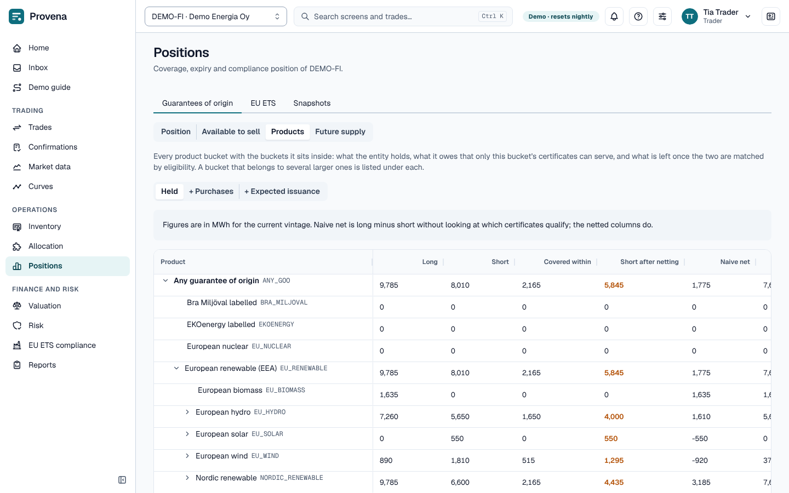
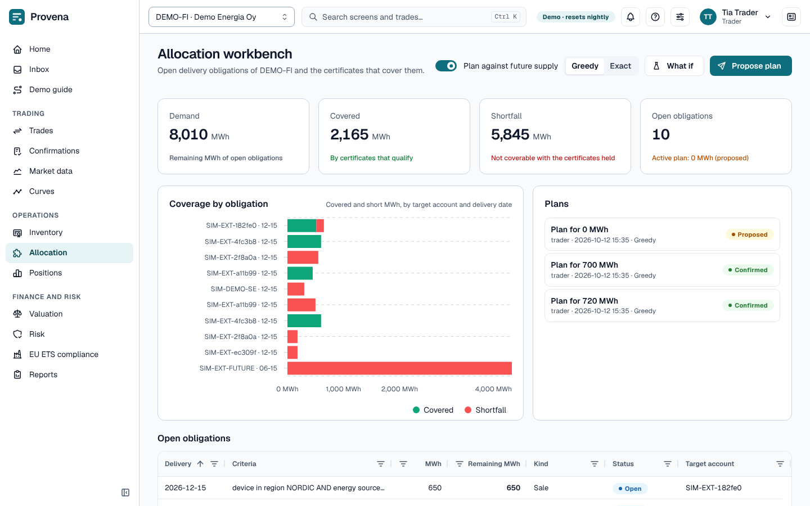
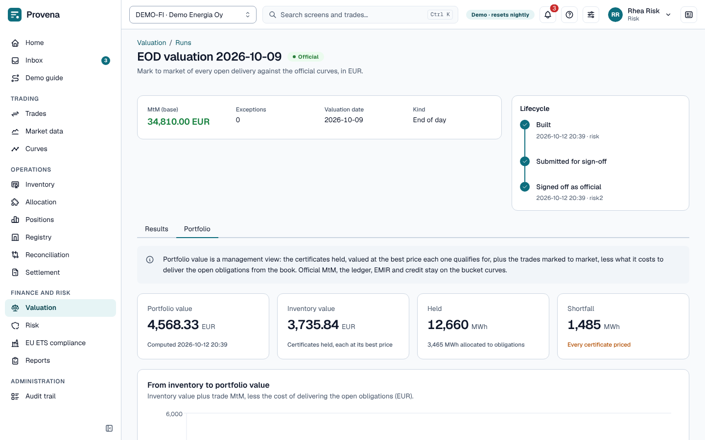
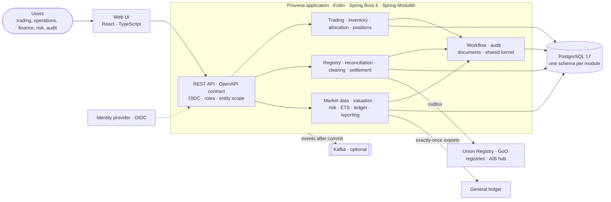

# Provena

**Energy-attribute trading, from trade to ledger.** Provena is an energy trading and risk management system (ETRM)
for guarantees of origin (GoO) and EU emission allowances (EUA). It follows a certificate or an allowance from the
trade to the registry, the invoice and the general ledger, for a European company group with several legal entities.

[](https://github.com/Pianonurmi/goo-ets-etrm/actions/workflows/ci.yml)
[](LICENSE)


## Why Provena

Spreadsheets and generic trading systems break exactly where energy-attribute certificates are hard:

- **A sale names criteria, not lots.** "Nordic hydro, 2026 production, unsupported" can be delivered by many
  certificates. Provena finds the ones that qualify and chooses among them by value.
- **Certificates live in registries.** The Union Registry, national GoO registries and the AIB hub are reached through
  APIs, files and manual steps. Provena keeps its own books, reconciles them with the registry's statements, and works
  every difference through to a resolution.
- **Value moves under four eyes.** Trades, transfers, curve sign-offs, valuation runs, limits and accounting changes
  each need a second person. The rule is checked in the service and again in the database.
- **Finance must close the month.** Postings follow rules held as data, the journal is immutable, and exports to the
  general ledger are exactly-once and reconciled.

## What it does

<table>
  <tr>
    <td width="50%" valign="top">
      <br>
      <sub><b>Trading.</b> Forwards, spots, futures and options, fixed or index priced; pre-trade checks and approval</sub>
    </td>
    <td width="50%" valign="top">
      <br>
      <sub><b>Portfolio.</b> Product hierarchy netted through eligibility; available to sell; future supply</sub>
    </td>
  </tr>
  <tr>
    <td width="50%" valign="top">
      <br>
      <sub><b>Allocation.</b> Value-based matching with greedy and exact (CP-SAT) solvers and shadow prices</sub>
    </td>
    <td width="50%" valign="top">
      <br>
      <sub><b>Valuation.</b> Official MtM on signed-off curves, P&amp;L explain and the portfolio value bridge</sub>
    </td>
  </tr>
  <tr>
    <td width="50%" valign="top">
      <br>
      <sub><b>Control.</b> One approval inbox for every role, with segregation of duties</sub>
    </td>
    <td width="50%" valign="top">
      <br>
      <sub><b>Finance.</b> Period end, gated hard close and exactly-once GL exports</sub>
    </td>
  </tr>
</table>

| Area | Capabilities |
|---|---|
| Trading and confirmations | GoO and EUA forwards, spots and futures; options on EUA futures with premiums and exercise at expiry; fixed or index prices; brokers, master agreements, intercompany mirror trades; deal versions; pre-trade limit checks; confirmations matched field by field |
| Inventory and registries | Certificate lots as number ranges with a hash-chained journal and bitemporal history; allowance holdings; registry instructions through an outbox to simulator, manual, file and API gateways; statement reconciliation with a break workflow |
| Allocation and portfolio | GoO criteria language; value-based allocation in EUR with the give-away reported; greedy and exact (CP-SAT) solvers; shadow prices; available to sell; flow-netted product hierarchy; purchases and expected issuance as future supply |
| Positions | GoO coverage by bucket and vintage, expiry ladder, EU ETS compliance ladder, snapshots |
| Clearing | Exchange-cleared EUA futures: daily variation margin, clearing statements reconciled with breaks, initial margin, margin calls under four eyes, delivery at the final settlement price |
| Market data and valuation | Prices and FX (bitemporal, plausibility checks), file imports, ECB reference rates; official curve snapshots under sign-off; mark to market per delivery discounted on rate curves, P&L explain (time, price, rates, FX), Black-76 options with greeks and a volatility curve, portfolio value and cheapest to deliver |
| Risk | Credit, position, tenor, stop-loss, compliance and GoO limits (concentration, expiry, basis); credit exposure with PFE and collateral; breaches; pre-trade checks |
| EU ETS compliance | Installations and aircraft operators, verified emissions, free allocation, surrender attribution, legal deadlines |
| Settlement | Settlement items, VAT rules as data, gap-free invoices with PDF, payments, credit notes, netting, ageing and VAT reports |
| Ledger and reporting | Posting rules as data, immutable journal, FIFO and weighted-average costing, period end (MtM by book type, NRV, provision, grant release, FX revaluation); cash flow hedge accounting with effectiveness tests; report catalogue with hashed exports; EMIR events and MiFID II ancillary activity |

## Built for regulated, audited operations

Provena is designed to the standards an energy trading company's risk, audit and IT functions apply to a system of
record.

### Reliability

- **Design targets** ([architecture plan](docs/architecture-plan.md#3-non-functional-requirements-design-targets)):
  - 99.9 % availability in business hours;
  - RPO 15 minutes and RTO 4 hours;
  - API p95 under 300 ms for reads and under 1 s for commands.
- **Stateless application on PostgreSQL 17.** It scales horizontally. On Kubernetes the database is a three-instance
  CloudNativePG cluster with a synchronous replica, a WAL archive and nightly backups
  ([Kubernetes](docs/operations/kubernetes.md)).
- **Disaster recovery is rehearsed, not assumed.** A monthly drill backs up, restores, compares row counts and
  verifies every hash chain, and a point-in-time recovery drill runs against a CloudNativePG cluster in CI
  ([disaster recovery](docs/operations/disaster-recovery.md)).
- **Long work stays out of the request.** Period end, valuation runs and report exports run asynchronously and are
  polled. A registry that keeps failing opens a circuit that pauses only its own dispatch. The chart scales on CPU or
  on request rate.
- **Measured under load** with k6 ([load testing](docs/operations/load-testing.md)). The stress profile ran 104
  virtual users at 556 requests/s with no errors. In the baseline profile, reads have p95 15 ms and writes 60 ms.
- **Observability:**
  - Prometheus metrics, OpenTelemetry traces and ECS JSON logs;
  - an `X-Trace-Id` header on every response;
  - in the Kubernetes profile, health probes on a separate management port
    ([observability](docs/operations/observability.md));
  - Prometheus alert rules in the Helm chart, each with a [runbook](docs/operations/runbooks/README.md).

### Security

- **Identity and access:**
  - OIDC resource server with audience checks: roles come from token claims, and each user is scoped to the legal
    entities they may see;
  - every command checks role and entity in the service, and segregation of duties is enforced again by database
    constraints;
  - `OperationGuardsIT` drives every API operation as a minimal-role, single-entity user and fails on any operation
    that answers it outside a reviewed allow-list; every path is also tried percent-encoded.
- **Least privilege in the database.** The application connects as a runtime role that cannot alter tables or
  switch off their triggers; migrations run separately as the owner.
- **Hardened web tier:**
  - strict Content Security Policy;
  - CSRF protection on session sign-in;
  - formula-safe CSV exports.
  - The axe and CSP checks run in CI ([UI testing](docs/ui/testing.md)), and an OWASP ZAP baseline scan runs
    weekly.
- **Supply chain:**
  - CycloneDX SBOMs for the backend, the web bundle and the image;
  - a Trivy gate that fails the build on high or critical fixable vulnerabilities;
  - actions and images pinned by digest, Gradle dependencies locked and checksummed;
  - Dependabot with a documented hold-back policy;
  - a weekly OWASP dependency check once an NVD API key is configured
    ([supply chain](docs/operations/supply-chain.md)).
- **Assurance:**
  - an independent [enterprise readiness review](docs/reviews/2026-10-enterprise-readiness.md) in October 2026,
    every code finding fixed by 0.17.0;
  - a threat model for the public demo ([showcase security](docs/security/showcase.md));
  - a prepared external penetration test: scope, accounts, rules of engagement
    ([penetration test](docs/security/penetration-test.md)).

### Robustness and data integrity

- **Append-only records.** Lot events, the journal, allowance movements, the audit trail and the task history are
  protected by triggers and hash-chained. A nightly job verifies every chain, and a daily digest of the chain heads is
  issued as a signed document. Mistakes are corrected by reversal, never by update.
- **Exactly-once effects:**
  - registry calls go through a transactional outbox and never run inside a database transaction;
  - deliveries and GL exports are idempotent;
  - a timeout is treated as unknown and reconciled, never resent blindly.
- **Bitemporal history.** Lots, prices and reference data can be read as of any past date, so a report can be
  reproduced.
- **Fault isolation.** Listeners that react to deliveries or receipts park a problem for attention instead of failing
  the transaction that caused it. A posting that cannot be made is recorded and replayed, never dropped.
- **Domain rules in code:**
  - no floating point in the domain: money and quantities are exact decimals;
  - periods are closed-open, and instants are UTC.

### Maintainability

- **A modular monolith.** It is one deployable, and the build verifies its module boundaries: 19 bounded contexts,
  each with its own schema and migrations, talk only through published APIs and domain events. An illegal
  dependency fails the build (`ModularityTests`).
- **Contracts are checked:**
  - the OpenAPI document is a committed contract;
  - the web client's types are generated from it;
  - a check fails when an API operation has no screen and no recorded reason.
- **Decisions are written down:** 55 architecture decision records, arc42 documentation, a contributor handbook and
  a user manual inside the application.
- **Tests at every level:**
  - unit and integration tests against PostgreSQL;
  - end-to-end business scenarios (`GoldenPathIT`, `MonthEndIT`);
  - Vitest component tests;
  - Playwright journeys that create their own data, with accessibility checks;
  - coverage floors for backend and web that only move up.
- **Strict tooling:** Kotlin warnings are errors, with detekt (no baselines) and ktlint; TypeScript is strict, with
  ESLint and Prettier. Every change reaches `main` through a pull request whose full CI run is green.

## Architecture



| Layer | Technology |
|---|---|
| Application | Kotlin on Java 25 with virtual threads, Spring Boot 4, Spring Modulith, jOOQ, Flyway |
| Optimisation | Google OR-Tools: CP-SAT for exact allocation, min-cost flow for portfolio valuation, GLOP for shadow prices |
| Data | PostgreSQL 17; monthly partitions for append-only tables; CloudNativePG for high availability |
| Web | React, TypeScript (strict), Vite, Mantine, AG Grid, TanStack Query; bundled into the application jar |
| Integration | Transactional outbox to registries; file, API and manual gateways; events to Kafka after commit; GL file exports |
| Operations | Docker image, Helm chart, Prometheus, OpenTelemetry, k6 load tests, scripted DR drill |

Each module under `modules/` is a bounded context with `api`, `domain`, `application` and adapter packages. A
module may use another only through its `api` package, which Spring Modulith verifies.

| Module | Responsibility |
|---|---|
| `referencedata`, `taxonomy`, `product` | Legal entities, books, counterparties, registries, devices; code hierarchies; products and the criteria language |
| `trade` | Deal capture, versions, four-eyes approval, confirmation matching, deliveries |
| `inventory`, `registry` | Certificate lots and allowance holdings; instruction outbox, gateways, statement formats, reconciliation |
| `allocation`, `position` | Matching engine, flow core, portfolio views; coverage and compliance ladders |
| `marketdata`, `valuation`, `risk` | Prices, FX and curves; MtM and P&L explain; limits, exposure and breaches |
| `etscompliance`, `settlement` | Installations, emissions and surrender; invoices, VAT, payments and netting |
| `clearing` | Clearing accounts, daily variation margin, clearing statements, margin calls |
| `ledger`, `reporting` | Posting rules, journal, period end, hedge accounting, GL interface; report catalogue, EMIR, MiFID II |
| `workflow`, `audit`, `document` | Approval inbox; append-only audit trail; issued PDFs |

More detail: the [architecture plan](docs/architecture-plan.md), [arc42](docs/arc42/) and the
[decision records](docs/adr/).

## Roadmap

| Increment | Delivered |
|---|---|
| 1 | Core domain and ledger: reference data, products and criteria, trades, inventory, allocation, positions, journal, audit |
| 2 | Registry integration, reconciliation, settlement and invoicing, confirmations, approval inbox |
| 3 | Market data, curves, valuation, risk and credit, ETS compliance, period-end accounting, reporting, GL interface |
| 4–5 | Web UI for every area, including the operations screens |
| 6 | Scale and operations: observability, supply chain, Java 25, Kafka, Kubernetes, partitioning, CP-SAT, load tests, DR |
| 7 | Public showcase: design system, demo data, in-app manual and guided tours |
| 8 | GoO portfolio management: value-based allocation, available to sell, product hierarchy, future supply, portfolio value, GoO limits |
| 9 | Housekeeping: current CI actions and dependency majors, versioned releases, this documentation |
| 10 | Portfolio follow-ups: figures patched in place in under a second at 100 000 lots, fast available-to-sell checks, GoO limits by vintage and pre-trade basis checks for sales, a give-away report |
| 11 | Valuation depth: discount curves and discounted MtM, time and rates in the P&L explain, cash flow hedge accounting |
| 12 | Futures margining: daily variation margin, clearing statements and breaks, initial margin, margin calls, delivery at the final settlement price |
| 13 | Options on EUA futures: volatility curve, Black-76 with greeks, premiums in the ledger, exercise at expiry, delta in risk |
| 14 | Production readiness after the October 2026 [review](docs/reviews/2026-10-enterprise-readiness.md): every operation guarded and tested, owner and runtime database roles, sealed and verified chains, money seams, alerts and runbooks, migrations as a job, a recovery drill, stricter gates |
| 15 | Maintainability: test seams, an injected clock, a beneficiary register with erasure, archive cuts, service splits, the demo seeder out of the production jar, roles in the OpenAPI document |
| 16 | Review leftovers: races and idempotency, PDFs rendered after commit, report retention, asynchronous long runs, a registry circuit, scaling on request rate |
| 17 | Finishing: repeatable clearing and hedge journeys, higher web coverage floors, no unsafe null dereferences left |

**On the path to production, waiting on outside input** (each a [GitHub issue](https://github.com/Pianonurmi/goo-ets-etrm/issues)):
- the external penetration test (#16);
- a DR drill against a production backup (#17);
- registry API specifications (G-REX, NECS) and AIB code lists (#18);
- sign-off of accounting policies, VAT rules and PFE add-ons (#19);
- the receiving GL's file specification, the EMIR field layout and trade repository delegation, market data vendors
  (#20);
- branch protection and a second maintainer (#21);
- a user acceptance period with real users and a dedicated load-test environment.

Each increment and milestone is listed in the [roadmap](docs/roadmap.md). Each increment is a minor version: releases
are tagged `vX.Y.Z` with notes in the [changelog](CHANGELOG.md), and images are published as `X.Y.Z`, `X.Y` and
`latest` ([releases](docs/operations/releases.md)).

## Try it

The public demo sits behind a sign-in; ask the maintainer for an account. In the demo:
- You act as a **persona**: trader, middle office, back office, risk, accountant, auditor or administrator. Each
  approving role has two personas, so you can play both sides of four eyes.
- Every company, counterparty and price is fictitious, and the data resets every night.
- Start with the demo guide at `/guide`. The `?` button opens the manual for the screen you are on.

### Run the showcase yourself

You need Docker with the compose plugin.

```bash
git clone https://github.com/Pianonurmi/goo-ets-etrm.git
cd goo-ets-etrm/ops/demo
cp .env.example .env && chmod 600 .env
# edit .env: set POSTGRES_PASSWORD and ETRM_DEMO_PASSWORD (12 characters or more)
docker compose pull && docker compose up -d
docker compose logs -f app      # "Demo data created in ... s" when the example portfolio is ready
```

The first start migrates the database and creates about six months of business through the API, in about a minute.
Then open `http://127.0.0.1/` and sign in as `demo`.

| Variable in `.env` | Purpose |
|---|---|
| `POSTGRES_PASSWORD` | Database password; only the containers use it |
| `ETRM_DEMO_PASSWORD` / `ETRM_DEMO_USERS` | Demo sign-in: user `demo`, or a list of `user:password` pairs |
| `ETRM_SITE_ADDRESS` | `:80` for plain HTTP; a domain name turns on HTTPS from Let's Encrypt |
| `ETRM_IMAGE` | `:main` follows every green commit; `:0.17.0` pins a release, `:0.17` takes its patches ([releases](docs/operations/releases.md)) |
| `ETRM_HTTP_PORT` / `ETRM_HTTPS_PORT` | Host ports for Caddy; change them when 80 or 443 are taken |

For a server with a domain, backups and a security checklist, see the [deployment guide](docs/deploy/vps.md). For a VM
on your own network, see the [homelab guide](docs/deploy/homelab.md).

### Developer build

You need JDK 25 (Gradle itself runs on JDK 21 or later), Node.js 22 with npm, and Docker.

```bash
docker compose -f ops/docker-compose.yml up -d postgres   # PostgreSQL 17 with the build databases

export ETRM_CODEGEN_DB_URL=jdbc:postgresql://localhost:5432/etrm_codegen
export ETRM_TEST_DB_URL=jdbc:postgresql://localhost:5432/etrm_test
export ETRM_DB_USER=etrm ETRM_DB_PASSWORD=etrm

./gradlew build                                            # lint, jOOQ code generation, all tests, coverage rule
SPRING_PROFILES_ACTIVE=dev,demo ./gradlew :apps:api:bootRun   # web UI and Swagger UI on http://127.0.0.1:8080
```

- **Why PostgreSQL first:** the build needs it before the tests, because the jOOQ sources are generated from a
  migrated database.
- **Web UI with hot reload:** `cd apps/web && npm run dev`. Vite proxies `/api` to port 8080.
- **Conventions:** the [contributor handbook](docs/contributing.md) lists the commands and conventions for working on the code; `CLAUDE.md` imports it for coding assistants.

## Documentation

- [User guide](docs/user-guide/getting-started.md): one page per area, also served in the application under `/help/`.
- [Documentation index](docs/README.md): architecture, domain notes, integration, operations and the glossary.
- [Web UI](docs/ui/README.md) and its [design system](docs/ui/design-system.md).
- Presentation: [the slides as PDF](docs/presentation/provena-deck.pdf) (18 slides: the product, architecture,
  reliability, security, robustness, maintainability and the roadmap), the same deck as a
  [web page with speaker notes](docs/presentation/provena-deck.html), and its [outline](docs/presentation/outline.md).

## Licence

Provena is source-available under the [PolyForm Noncommercial License 1.0.0](LICENSE): you may read, run, change
and share it for any noncommercial purpose. Commercial use needs a separate licence; ask the maintainer through
GitHub. Third-party libraries, fonts and images keep their own licences, listed in the SBOMs each CI run publishes.
The PDF documents embed Liberation Sans, bundled under the SIL Open Font License 1.1
([`OFL.txt`](modules/document/src/main/resources/documents/fonts/OFL.txt)).
