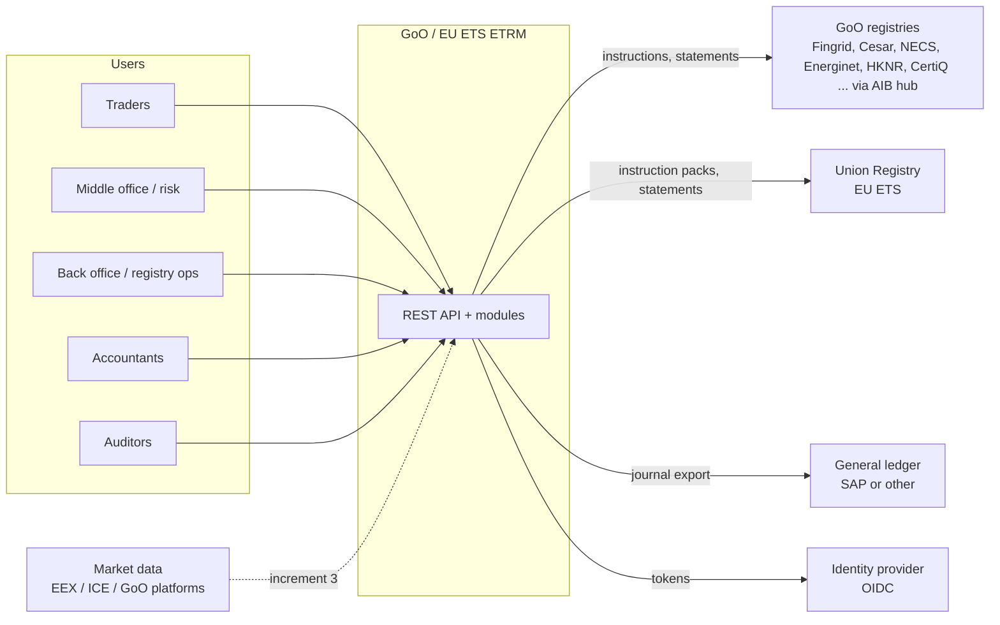

# 3. Context and scope

**In scope (increment 1)**: everything inside the ETRM box, the simulator / manual / file registry gateways, CSV
statement import, CSV GL export.

**Out of scope for now**: registry APIs, market data feeds, exchange and clearing connectivity, counterparty
confirmation matching platforms, web UI (increment 4), EMIR / MiFIR reporting.
