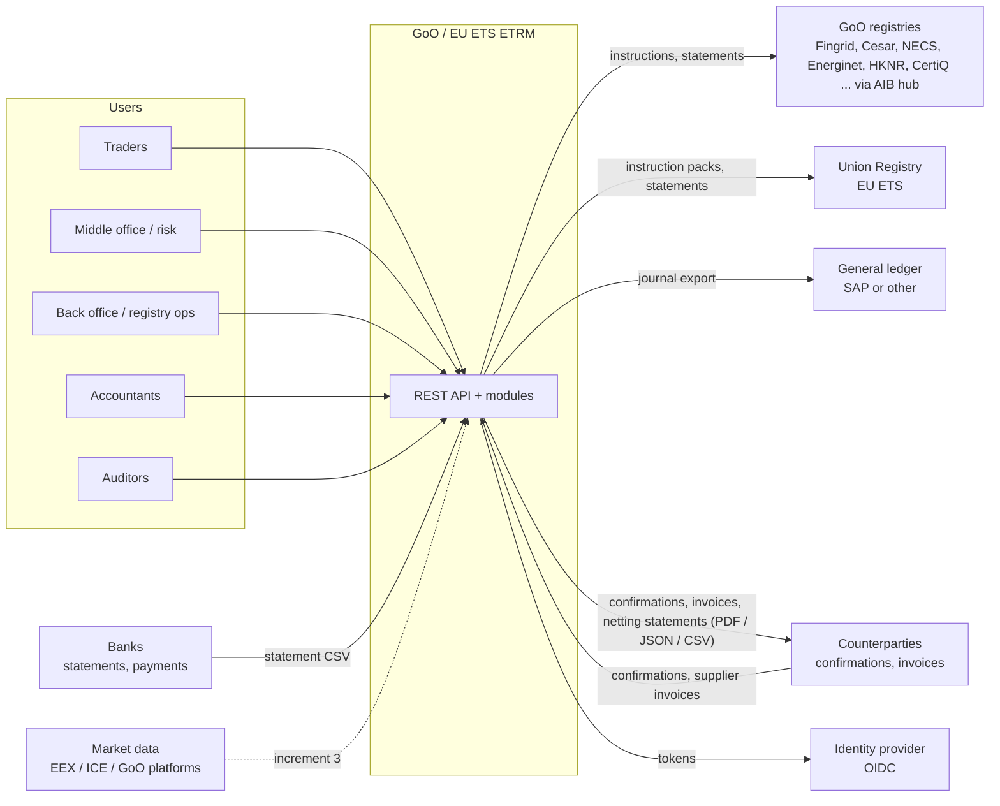

# 3. Context and scope

**In scope (increments 1 and 2)**:
- everything inside the ETRM box;
- registry gateways: simulator, manual (the Union Registry), file, and an API channel with ETRM's generic REST
  contract;
- statement formats as data;
- counterparty confirmations as JSON, CSV or manual entry;
- invoices, credit notes and netting statements as PDF, CSV and JSON;
- bank statement CSV;
- CSV GL export.

**Out of scope for now**:
- registry-specific API mappings (G-REX, NECS) until their specifications are available;
- market data feeds;
- exchange and clearing connectivity;
- EFETnet / CpML transport;
- e-invoicing (Peppol);
- bank payment files (pain.001, camt.053);
- the web UI (increment 4);
- EMIR / MiFIR reporting.
