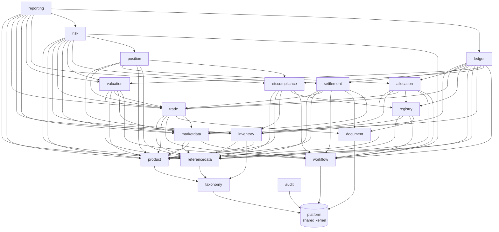

# 5. Building block view

## Level 1: modules



Arrows are compile-time dependencies on another module's `api` (or `criteria`) named interface, verified by
`ModularityTests`. Everything else flows through domain events.

| Module | Responsibility | Key types |
|---|---|---|
| `platform` | Money, Quantity, LocalDateRange, bitemporal types, DomainEvent, errors, Actor/Role and entity scope, JSON, CSV, hash chain, savepoints | `Money`, `Quantity`, `LocalDateRange`, `DomainEvent`, `HashChain` |
| `taxonomy` | ltree-backed code hierarchies and region sets | `TaxonomyQuery`, `TaxonomySnapshot` |
| `referencedata` | Legal entities (accounting and obligation policies), books, counterparties (settlement terms), registries and accounts (trusted list), production devices, calendars, addresses, VAT registrations, bank accounts, four-eyes change requests, history | `ReferenceDataQuery`, `PartyDetailsQuery`, `ChangeRequestCommand` |
| `product` | Product families, allowance catalogue, criteria language, product buckets | `Criterion`, `BoundCriterion`, `CriteriaService`, `ProductBucketQuery` |
| `marketdata` | Instruments and aliases, bitemporal quotes and FX rates, import formats as data, ECB adapter, price indices and fixings, curves with official snapshots (ADR 0017, 0018) | `FxRates`, `MarketDataQuery`, `CurveQuery`, `GooMarks`, `IndexFixings` |
| `trade` | Deal capture, versions, approval, obligations-open policy, confirmations (ours issued as JSON and PDF, theirs matched), deliveries | `TradeCommand`, `TradeQuery`, `ConfirmationCommand`, `DeliveryObligationView` |
| `inventory` | Certificate lots, allowance holdings, statements and reconciliation breaks (fingerprint, lifecycle) | `LotCommand`, `LotQuery`, `AllowanceHoldingCommand`, `ReconciliationCommand` |
| `registry` | Transfer routes, instruction outbox and dispatcher, gateways (simulator, manual, file, API), statement formats, break resolution | `RegistryInstructionCommand`, `RegistryGateway`, `RegistryApiMapping`, `BreakResolutionCommand` |
| `allocation` | Obligations, coverage analysis, allocation plans, allowance deliveries and purchase receipt matching | `AllocationCommand`, `AllocationQuery`, `ObligationCommand`, `DeliveryCommand` |
| `settlement` | Settlement items per delivery, VAT rules, price fixing, invoices with gap-free numbers, payments, credit notes, netting, reports (ADR 0014) | `InvoiceCommand`, `PaymentCommand`, `NettingCommand`, `VatRuleQuery`, `SettlementReports` |
| `position` | GoO and ETS position reports, snapshots | `PositionQuery`, `PositionCommand` |
| `ledger` | Chart of accounts, posting rules (changes under four eyes), journal, costing, periods, period end (MtM, NRV, provision, grant, FX; ADR 0021), GL interface (ADR 0024) | `LedgerCommand`, `LedgerQuery`, `PostingFacts`, `PeriodEndCommand`, `GlInterfaceCommand` |
| `valuation` | Valuation runs with sign-off, MtM per delivery schedule, P&L explain (ADR 0019) | `ValuationQuery`, `ValuationCommand` |
| `etscompliance` | Installations, emissions (verified under four eyes), free allocation, surrender attribution and requests, deadlines (ADR 0020) | `EtsComplianceQuery`, `EtsComplianceCommand` |
| `risk` | Limits, credit exposure and support, utilisation and breaches, pre-trade check (ADR 0022) | `RiskQuery`, `RiskCommand`, `TradeApprovalCheck` (implemented) |
| `reporting` | Report catalogue with logged exports, EMIR events and completeness, MiFID ancillary activity (ADR 0023) | `ReportingQuery`, `ReportingCommand` |
| `workflow` | Generic approval inbox: task types registered by owning modules, four-eyes, roles, scope, assignment, SLA, escalation (ADR 0011) | `WorkflowCommand`, `WorkflowQuery`, `TaskHandler` |
| `document` | Rendered (Mustache to PDF) and stored documents, immutable and hashed (ADR 0013) | `DocumentCommand`, `DocumentQuery` |
| `audit` | Event and command audit trail | `AuditQuery`, `AuditCommand` |

## Level 2: inside a module

Every module follows the same layout:

```
com.pianonurmi.etrm.<module>
├── <Module>Module.kt          @PackageInfo @ApplicationModule(allowedDependencies = [...])
├── api/                       public contracts: commands, queries, views, events   (@NamedInterface("api"))
├── domain/                    aggregates, value objects, pure logic, repository ports
├── application/               @Service use cases, @EventListener handlers, scheduled jobs
└── adapter/
    ├── jooq/                  repository implementations over generated jOOQ types
    ├── rest/                  controllers (thin, map to api commands/queries)
    └── gateway/ ...           external systems
```

Database: schema `etrm_<module>`, migrations under `src/main/resources/db/migration/<module>`, jOOQ sources
generated at build time from the migrated schema.
