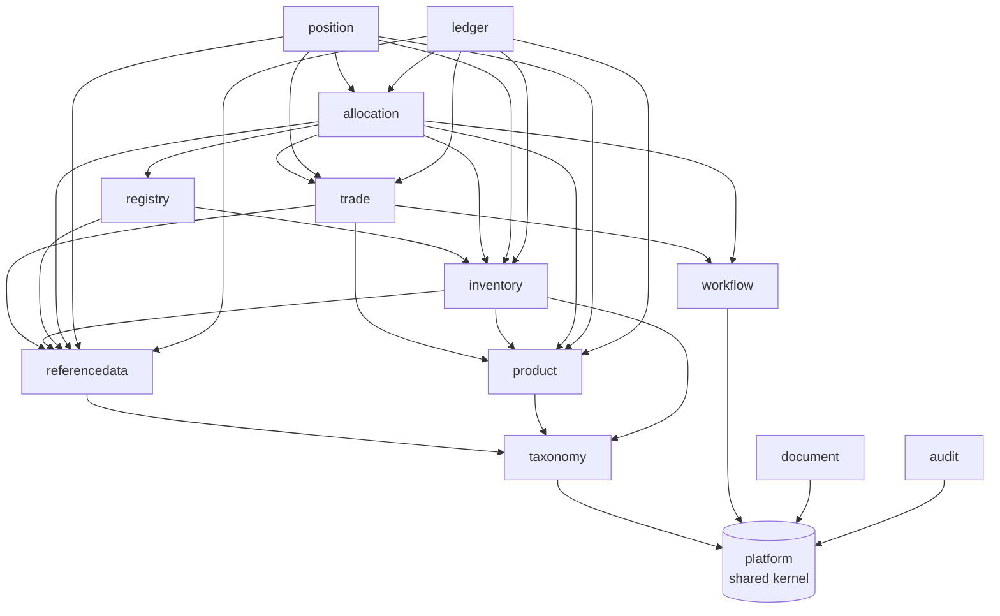

# 5. Building block view

## Level 1: modules



Arrows are compile-time dependencies on another module's `api` (or `criteria`) named interface, verified by
`ModularityTests`. Everything else flows through domain events.

| Module | Responsibility | Key types |
|---|---|---|
| `platform` | Money, Quantity, LocalDateRange, bitemporal types, DomainEvent, errors, Actor/Role and entity scope, JSON, CSV, hash chain, savepoints | `Money`, `Quantity`, `LocalDateRange`, `DomainEvent`, `HashChain` |
| `taxonomy` | ltree-backed code hierarchies and region sets | `TaxonomyQuery`, `TaxonomySnapshot` |
| `referencedata` | Legal entities and accounting policies, books, counterparties, registries and accounts, production devices, calendars, history | `ReferenceDataQuery`, `ReferenceDataCommand` |
| `product` | Product families, allowance catalogue, criteria language, product buckets | `Criterion`, `BoundCriterion`, `CriteriaService`, `ProductBucketQuery` |
| `trade` | Deal capture, versions, approval, confirmation, deliveries, obligations | `TradeCommand`, `TradeQuery`, `DeliveryObligationView` |
| `inventory` | Certificate lots, allowance holdings, reconciliation | `LotCommand`, `LotQuery`, `AllowanceHoldingCommand`, `ReconciliationCommand` |
| `registry` | Transfer routes, instructions, gateways, statement parsing | `RegistryInstructionCommand`, `TransferRouteQuery`, `RegistryGateway` |
| `allocation` | Obligations, coverage analysis, allocation plans | `AllocationCommand`, `AllocationQuery`, `ObligationCommand` |
| `position` | GoO and ETS position reports, snapshots | `PositionQuery`, `PositionCommand` |
| `ledger` | Chart of accounts, posting rules, journal, costing, periods, GL export | `LedgerCommand`, `LedgerQuery`, `PostingFacts` |
| `workflow` | Generic approval inbox: task types registered by owning modules, four-eyes, roles, scope, assignment, SLA, escalation (ADR 0011) | `WorkflowCommand`, `WorkflowQuery`, `TaskHandler` |
| `document` | Rendered (Mustache to PDF) and stored documents, immutable and hashed (ADR 0013) | `DocumentCommand`, `DocumentQuery` |
| `audit` | Event and command audit trail | `AuditQuery`, `AuditCommand` |

## Level 2: inside a module

Every module follows the same layout:

```
com.pianonurmi.etrm.<module>
├── <Module>Module.kt          @PackageInfo @ApplicationModule(allowedDependencies = [...])
├── api/                       public contracts: commands, queries, views, events   (@NamedInterface("api"))
├── domain/                    aggregates, value objects, pure logic, repository ports
├── application/               @Service use cases, @EventListener handlers, scheduled jobs
└── adapter/
    ├── jooq/                  repository implementations over generated jOOQ types
    ├── rest/                  controllers (thin, map to api commands/queries)
    └── gateway/ ...           external systems
```

Database: schema `etrm_<module>`, migrations under `src/main/resources/db/migration/<module>`, jOOQ sources
generated at build time from the migrated schema.
