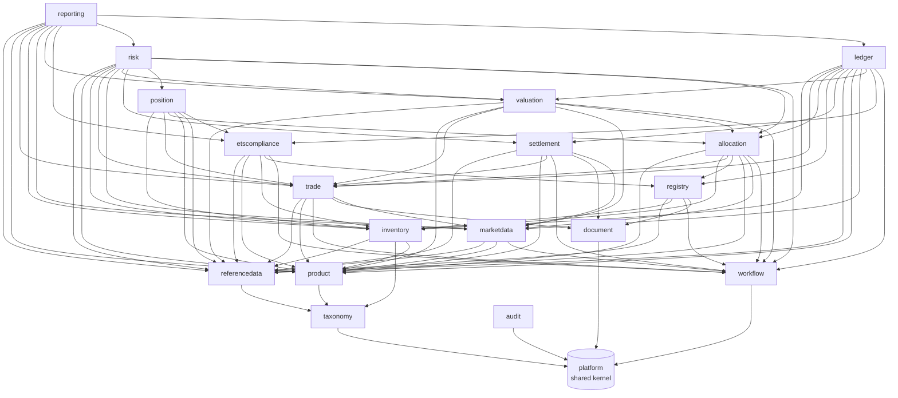
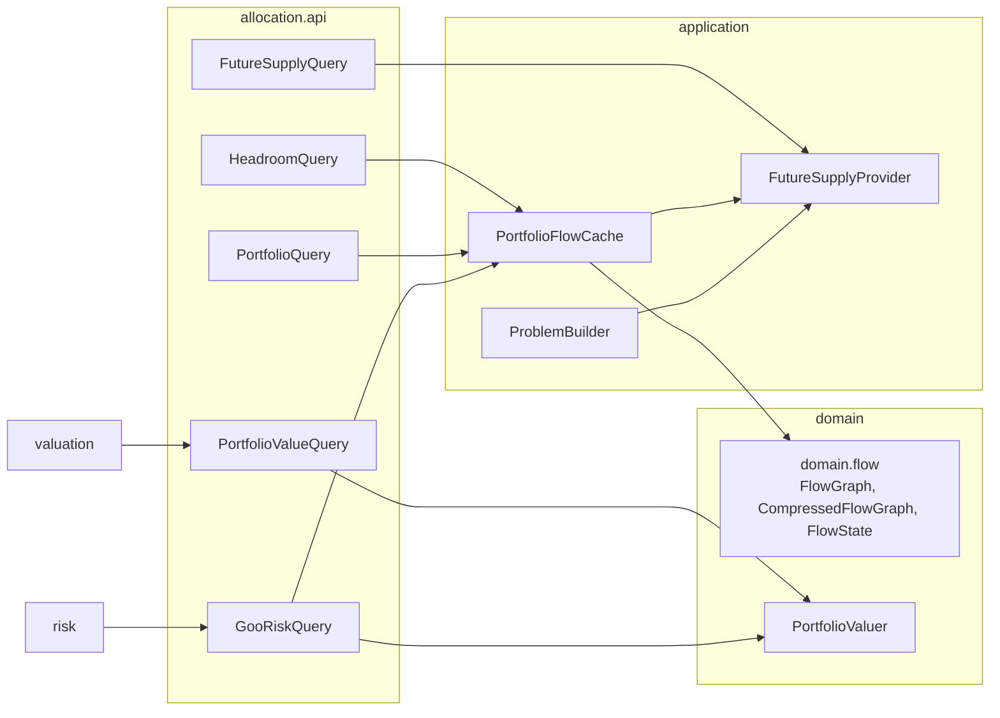
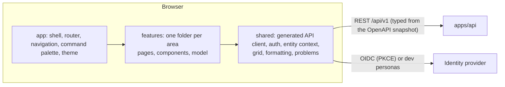

# 5. Building block view

## Level 1: modules



Arrows are compile-time dependencies on another module's `api` (or `criteria`) named interface, verified by
`ModularityTests`. Everything else flows through domain events.

Increment 8 adds two arrows, valuation → allocation and risk → allocation, both to `allocation :: api`. Allocation
depends on neither valuation nor risk, so no cycle forms. Valuation and risk call allocation for the portfolio
value and the GoO measures; allocation reads forecasts from `referencedata :: api` and open purchases from
`trade :: api`, which it already depended on.

| Module | Responsibility | Key types |
|---|---|---|
| `platform` | Money, Quantity, LocalDateRange, bitemporal types, DomainEvent, errors, Actor/Role and entity scope, JSON, CSV, hash chain, savepoints | `Money`, `Quantity`, `LocalDateRange`, `DomainEvent`, `HashChain` |
| `taxonomy` | ltree-backed code hierarchies and region sets | `TaxonomyQuery`, `TaxonomySnapshot` |
| `referencedata` | Legal entities (accounting and obligation policies), books, counterparties (settlement terms), registries and accounts (trusted list), production devices with monthly forecasts and load factors, calendars, addresses, VAT registrations, bank accounts, four-eyes change requests, history | `ReferenceDataQuery`, `PartyDetailsQuery`, `ChangeRequestCommand`, `ProductionForecastQuery` |
| `product` | Product families, allowance catalogue, criteria language, product buckets | `Criterion`, `BoundCriterion`, `CriteriaService`, `ProductBucketQuery` |
| `marketdata` | Instruments and aliases, bitemporal quotes and FX rates, import formats as data, ECB adapter, price indices and fixings, curves with official snapshots (ADR 0017, 0018) | `FxRates`, `MarketDataQuery`, `CurveQuery`, `GooMarks`, `IndexFixings` |
| `trade` | Deal capture, versions, approval, obligations-open policy, confirmations (ours issued as JSON and PDF, theirs matched), deliveries | `TradeCommand`, `TradeQuery`, `ConfirmationCommand`, `DeliveryObligationView` |
| `inventory` | Certificate lots, allowance holdings, statements and reconciliation breaks (fingerprint, lifecycle) | `LotCommand`, `LotQuery`, `AllowanceHoldingCommand`, `ReconciliationCommand` |
| `registry` | Transfer routes, instruction outbox and dispatcher, gateways (simulator, manual, file, API), statement formats, break resolution | `RegistryInstructionCommand`, `RegistryGateway`, `RegistryApiMapping`, `BreakResolutionCommand` |
| `allocation` | Obligations, coverage analysis, value-based allocation plans (ADR 0035), available to sell and the flow-netted portfolio view (ADR 0036, 0037), future supply (ADR 0038), portfolio value and GoO risk measures (ADR 0039, 0040), allowance deliveries and purchase receipt matching | `AllocationCommand`, `AllocationQuery`, `ObligationCommand`, `DeliveryCommand`, `HeadroomQuery`, `PortfolioQuery`, `FutureSupplyQuery`, `PortfolioValueQuery`, `GooRiskQuery` |
| `settlement` | Settlement items per delivery, VAT rules, price fixing, invoices with gap-free numbers, payments, credit notes, netting, reports (ADR 0014) | `InvoiceCommand`, `PaymentCommand`, `NettingCommand`, `VatRuleQuery`, `SettlementReports` |
| `position` | GoO and ETS position reports, snapshots | `PositionQuery`, `PositionCommand` |
| `ledger` | Chart of accounts, posting rules (changes under four eyes), journal, costing, periods, period end (MtM, NRV, provision, grant, FX; ADR 0021), GL interface (ADR 0024) | `LedgerCommand`, `LedgerQuery`, `PostingFacts`, `PeriodEndCommand`, `GlInterfaceCommand` |
| `valuation` | Valuation runs with sign-off, MtM per delivery schedule, P&L explain (ADR 0019), portfolio value and portfolio explain as a management view (ADR 0039) | `ValuationQuery`, `ValuationCommand` |
| `etscompliance` | Installations, emissions (verified under four eyes), free allocation, surrender attribution and requests, deadlines (ADR 0020) | `EtsComplianceQuery`, `EtsComplianceCommand` |
| `risk` | Limits including GoO concentration, expiry and basis (ADR 0040), credit exposure and support, utilisation and breaches, pre-trade check (ADR 0022) | `RiskQuery`, `RiskCommand`, `TradeApprovalCheck` (implemented) |
| `reporting` | Report catalogue with logged exports, EMIR events and completeness, MiFID ancillary activity (ADR 0023) | `ReportingQuery`, `ReportingCommand` |
| `workflow` | Generic approval inbox: task types registered by owning modules, four-eyes, roles, scope, assignment, SLA, escalation (ADR 0011) | `WorkflowCommand`, `WorkflowQuery`, `TaskHandler` |
| `document` | Rendered (Mustache to PDF) and stored documents, immutable and hashed (ADR 0013) | `DocumentCommand`, `DocumentQuery` |
| `audit` | Event and command audit trail | `AuditQuery`, `AuditCommand` |

## Level 2: inside the allocation module

Increment 8 gave `allocation` more building blocks. They sit in the module's own packages; other modules see only
the interfaces in `allocation.api`.



| Block | Responsibility |
|---|---|
| `allocation.domain.flow` | The flow core (ADR 0036): `FlowGraph` (Dinic with trials and rollback), `CompressedFlowGraph` (interchangeable obligations and supply merged exactly) and `FlowState` (a solved flow, headroom, joint headroom, binding supply). Pure Kotlin, no I/O. Coverage, available to sell and the portfolio view all run on it |
| `PortfolioFlowCache` | Prepared flows per entity and tier, each with a stamp of the entity's holdings, open obligations, buckets and date (and, beyond the held tier, a digest of future supply). Every read compares the stamp with the database. Serves `HeadroomQuery`, `PortfolioQuery` and `GooRiskQuery`, and the pre-trade check `GOO_HEADROOM` |
| `FutureSupplyProvider` | Builds the contracted tier (open GoO purchase schedules) and the expected tier (own devices' forecasts less issuance, from `ProductionForecastQuery`) as stand-in lot classes for the problem builder and the cache |
| `PortfolioValuer` | The valuation-grade allocation (ADR 0039): a min-cost max-flow in integer cents, deterministic, no side constraints. Behind `PortfolioValueQuery` and the basis measure of `GooRiskQuery` |

| Interface | Owner | Used by |
|---|---|---|
| `HeadroomQuery` | allocation | the REST layer (available-to-sell table and capture form hint); the pre-trade check `GOO_HEADROOM` is allocation's own `TradeApprovalCheck`, run by risk's Check limits |
| `PortfolioQuery` | allocation | the REST layer (Products view, Positions → GoO) |
| `FutureSupplyQuery` | allocation | the REST layer (future supply view) |
| `PortfolioValueQuery` | allocation | valuation (the bridge kept with each run, the explain), realised give-away |
| `GooRiskQuery` | allocation | risk (GoO limits) |
| `ProductionForecastQuery` | referencedata | allocation (`FutureSupplyProvider`), the device forecast screen |

## Level 2: inside a module

Every module follows the same layout:

```
com.pianonurmi.etrm.<module>
├── <Module>Module.kt          @PackageInfo @ApplicationModule(allowedDependencies = [...])
├── api/                       public contracts: commands, queries, views, events   (@NamedInterface("api"))
├── domain/                    aggregates, value objects, pure logic, repository ports
├── application/               @Service use cases, @EventListener handlers, scheduled jobs
└── adapter/
    ├── jooq/                  repository implementations over generated jOOQ types
    ├── rest/                  controllers (thin, map to api commands/queries)
    └── gateway/ ...           external systems
```

Database: schema `etrm_<module>`, migrations under `src/main/resources/db/migration/<module>`, jOOQ sources
generated at build time from the migrated schema.

## Web UI (`apps/web`)

A single-page application served by the API jar from the same origin (ADR 0025). It holds no business rules: the
API decides, the UI shows the decision.



| Part | Responsibility |
|---|---|
| `src/app` | Boot (UI config, sign-in), providers, lazy routes, navigation filtered by role, command palette (mod+K), accessible theme |
| `src/shared/api` | `openapi-fetch` client and TanStack Query hooks typed from `apps/api/openapi/etrm-api.json` (ADR 0027), problem errors, downloads |
| `src/shared/auth` | OIDC with PKCE or dev personas (ADR 0026), session (`/me`), permissions keyed by operation id (ADR 0028) |
| `src/features/*` | Screens per area: inbox, trades, confirmations, criteria, inventory, allocation, positions, registry, reconciliation, settlement, market data, valuation, risk, ETS, ledger, month end, reports, admin, audit. Pure logic lives in `model/` with unit tests |
| `e2e/` | Playwright journeys against the jar with demo data, accessibility (axe) and CSP checks |
