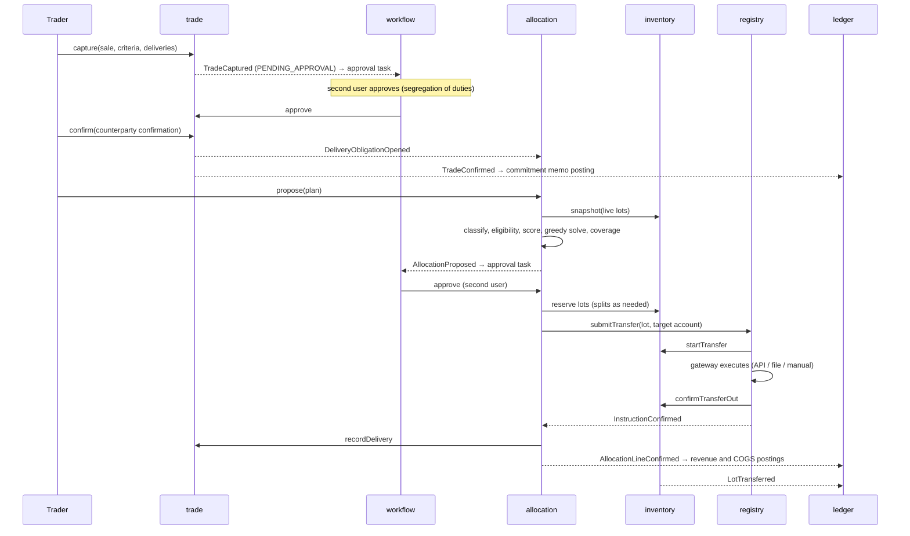

# 6. Runtime view

## Golden path: GoO sale from capture to ledger

## Backdated correction (bitemporal)

A label certificate arrives in October for a lot received in February, effective from January: the correction is
recorded with `effectiveAt = 2026-01-01`. The version trigger closes the current row in transaction time, re-records
the superseded version for valid time before January, and inserts the new version from January. Queries "as known
before October" still see the old labels; queries "as known now, effective December 2025" see the old labels; queries
"as known now, effective today" see the new labels.

## Registry failure

A transfer rejected by the registry returns the lot from `IN_TRANSFER` to `RESERVED`, marks the allocation line
`FAILED`, and leaves the plan `INSTRUCTED`. The operator retries the instruction or cancels the plan, which releases the
remaining reservations.
