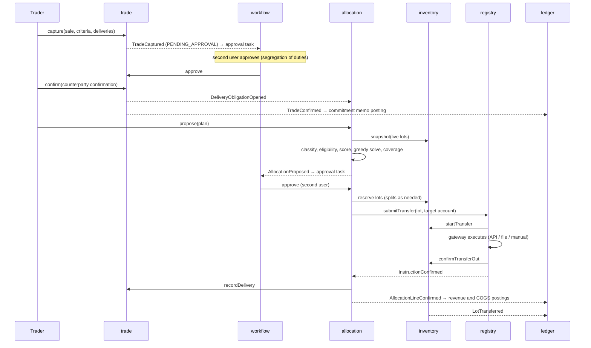
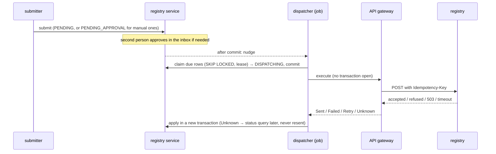
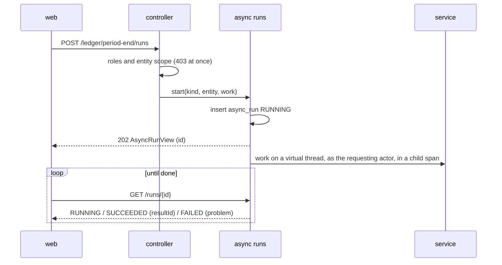

# 6. Runtime view

## Golden path: GoO sale from capture to ledger

## Backdated correction (bitemporal)

A label certificate arrives in October for a lot received in February, effective from January: the correction is
recorded with `effectiveAt = 2026-01-01`. The version trigger closes the current row in transaction time, re-records
the superseded version for valid time before January, and inserts the new version from January. Queries "as known
before October" still see the old labels; queries "as known now, effective December 2025" see the old labels; queries
"as known now, effective today" see the new labels.

## Registry failure

A transfer rejected by the registry returns the lot from `IN_TRANSFER` to `RESERVED`, marks the allocation line
`FAILED`, and leaves the plan `INSTRUCTED`. The operator retries the instruction or cancels the plan, which releases the
remaining reservations.

## Registry instruction through the outbox (increment 2)

## EUA sale from delivery to cash (increment 2)

1. **Deliver.** `POST /deliveries/allowances` creates an `ALLOWANCE_TRANSFER`, which reserves the allowances. A
   second person approves it, and the operator executes it in the Union Registry and confirms.
2. **Record the delivery.** Confirmation records SALE on the holding (the ledger books proceeds and cost), then
   records the trade delivery (keyed by the instruction id). `DeliveryRecorded` creates a settlement item with VAT
   determined from the rules, and releases the commitment memo.
3. **Invoice.** An invoice run drafts the invoice. It is submitted and approved by a second person, which issues it
   (gap-free number, frozen details, PDF). The ledger moves the accrued receivable to invoiced.
4. **Pay.** A payment quoting the invoice number is applied to it. When the invoice is paid, the trade becomes
   SETTLED. The ledger clears the invoiced receivable through unapplied cash.

## Reconciliation break (increment 2)

1. A holdings statement shows a range we do not hold. The break is fingerprinted, and a `RECONCILIATION_BREAK` task
   opens.
2. Claiming the task puts the break under investigation.
3. The operator records the missing receipt, which receives the lot and resolves the break in one transaction. The
   task closes.
4. A later statement without the discrepancy would have cleared the break automatically.

## Confirmation matching (increment 2)

1. Approving an external trade issues our confirmation (JSON and PDF).
2. The counterparty's confirmation is matched field by field:
   - a match confirms the trade as `system`;
   - a mismatch opens `CONFIRMATION_BREAK`, where a second person overrides it (the trade is confirmed) or disputes it.
3. Amending the trade re-matches open confirmations against the next issue.

## A registry that keeps failing (increment 16)

After `etrm.registry.circuit.failures` transport failures in a row to one registry, its circuit opens: the dispatcher
sends nothing more to that registry and the registry screen shows it as paused. After
`etrm.registry.circuit.cool-down` the next dispatch sends one instruction as a probe; success closes the circuit, a
failure keeps it open for another cool-down. An operator can also resume it (`POST /api/v1/registry/circuits/{code}/resume`).
Only transport failures count. A refusal is an answer, and an unknown outcome is still queried, never resent (ADR 0012).

## A long operation run outside the request (increment 16)

Period end, valuation runs and report exports run this way. The run row carries a heartbeat; another instance fails
a run whose heartbeat stopped (`etrm.async-runs.abandon-after`), so a restart never leaves a run running forever. A
failed run's `problem` is the problem the request would have answered, and the web shows it the same way.

## Month end (increment 3)

1. **Market data.** Quotes and FX rates are imported (or entered), and suspect quotes are flagged. Each curve's
   snapshot for the date is built, submitted and signed off by a second person (`CURVE_SIGN_OFF`).
2. **Valuation.** The end-of-day job values every open trade per delivery schedule and submits the run. Risk signs it
   off (`VALUATION_SIGN_OFF`). Sign-off then triggers:
   - risk re-measures exposures and limits;
   - reporting records EMIR valuations for FC and NFC+ entities;
   - the P&L explain against the previous official run is stored.
3. **Period end.** On the first working days of the next month the accountant runs the period end. It is gated on
   the official valuation of the last business day. It posts MtM per book type policy (reversed on day one), NRV
   write-downs, the emission provision, the free allocation grant release and FX revaluation, each as the difference
   to what is booked.
4. **Close.** Soft close, then the GL export: each entry once, in the GL's layout. Then delivery and the GL's
   acknowledgement, import of the GL closing balances, and reconciliation. The hard close is refused until
   everything is exported, the last export is acknowledged and the period end has run.

## Trade over a credit limit (increment 3)

1. Capture runs risk's pre-trade check. The last measured exposure plus the trade's PFE exceeds the counterparty's
   credit limit, so the trade carries a `CREDIT_LIMIT` finding that requires risk approval.
2. The trade goes to the inbox even below the approval threshold. Middle office cannot approve it; a RISK user can.
3. Approval re-measures the entity. The limit is breached, so a `LIMIT_BREACH` task opens.
4. Risk approves a higher limit (`LIMIT_CHANGE`, four eyes). The old limit retires, its breach closes, and the task
   completes itself.
