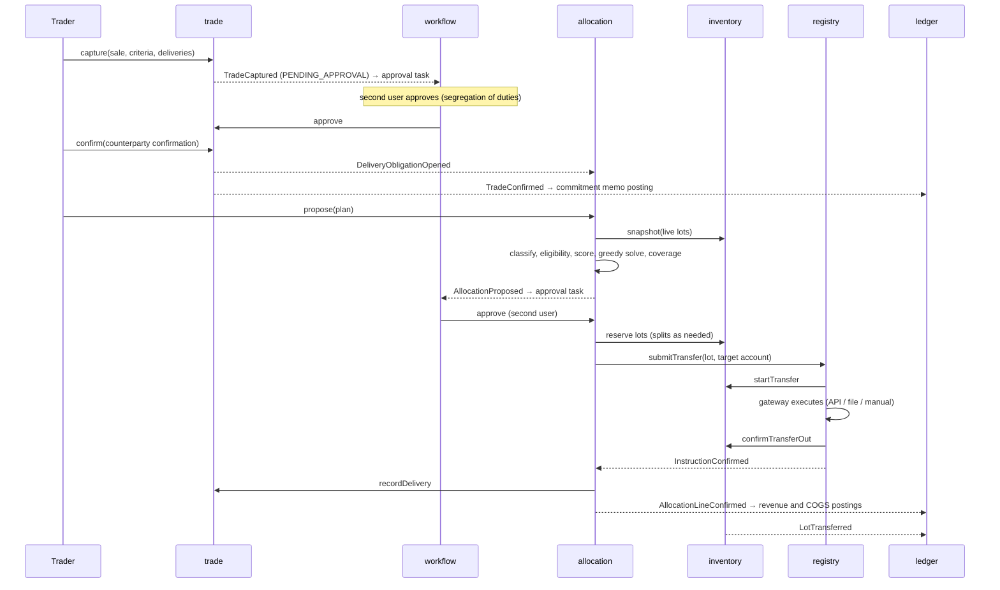
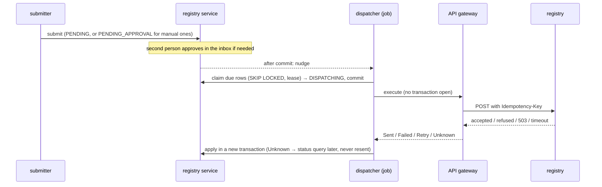

# 6. Runtime view

## Golden path: GoO sale from capture to ledger

## Backdated correction (bitemporal)

A label certificate arrives in October for a lot received in February, effective from January: the correction is
recorded with `effectiveAt = 2026-01-01`. The version trigger closes the current row in transaction time, re-records
the superseded version for valid time before January, and inserts the new version from January. Queries "as known
before October" still see the old labels; queries "as known now, effective December 2025" see the old labels; queries
"as known now, effective today" see the new labels.

## Registry failure

A transfer rejected by the registry returns the lot from `IN_TRANSFER` to `RESERVED`, marks the allocation line
`FAILED`, and leaves the plan `INSTRUCTED`. The operator retries the instruction or cancels the plan, which releases the
remaining reservations.

## Registry instruction through the outbox (increment 2)

## EUA sale from delivery to cash (increment 2)

1. **Deliver.** `POST /deliveries/allowances` creates an `ALLOWANCE_TRANSFER`, which reserves the allowances. A
   second person approves it, and the operator executes it in the Union Registry and confirms.
2. **Record the delivery.** Confirmation records SALE on the holding (the ledger books proceeds and cost), then
   records the trade delivery (keyed by the instruction id). `DeliveryRecorded` creates a settlement item with VAT
   determined from the rules, and releases the commitment memo.
3. **Invoice.** An invoice run drafts the invoice. It is submitted and approved by a second person, which issues it
   (gap-free number, frozen details, PDF). The ledger moves the accrued receivable to invoiced.
4. **Pay.** A payment quoting the invoice number is applied to it. When the invoice is paid, the trade becomes
   SETTLED. The ledger clears the invoiced receivable through unapplied cash.

## Reconciliation break (increment 2)

1. A holdings statement shows a range we do not hold. The break is fingerprinted, and a `RECONCILIATION_BREAK` task
   opens.
2. Claiming the task puts the break under investigation.
3. The operator records the missing receipt, which receives the lot and resolves the break in one transaction. The
   task closes.
4. A later statement without the discrepancy would have cleared the break automatically.

## Confirmation matching (increment 2)

1. Approving an external trade issues our confirmation (JSON and PDF).
2. The counterparty's confirmation is matched field by field:
   - a match confirms the trade as `system`;
   - a mismatch opens `CONFIRMATION_BREAK`, where a second person overrides it (the trade is confirmed) or disputes it.
3. Amending the trade re-matches open confirmations against the next issue.
