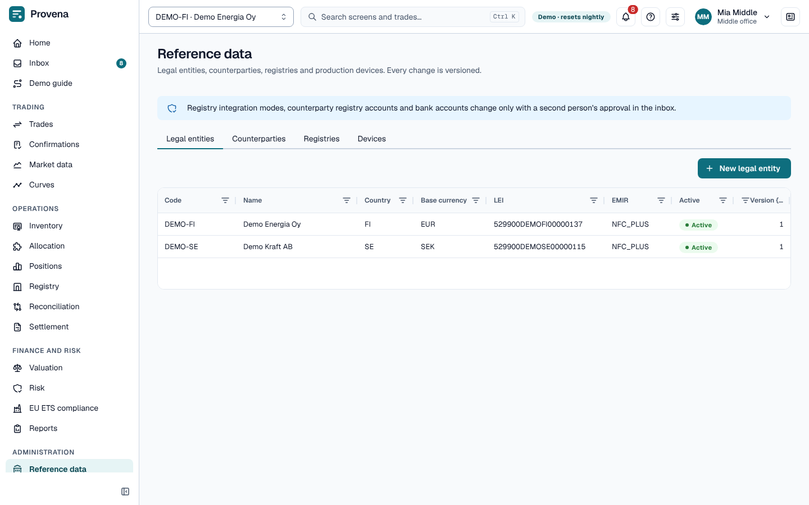
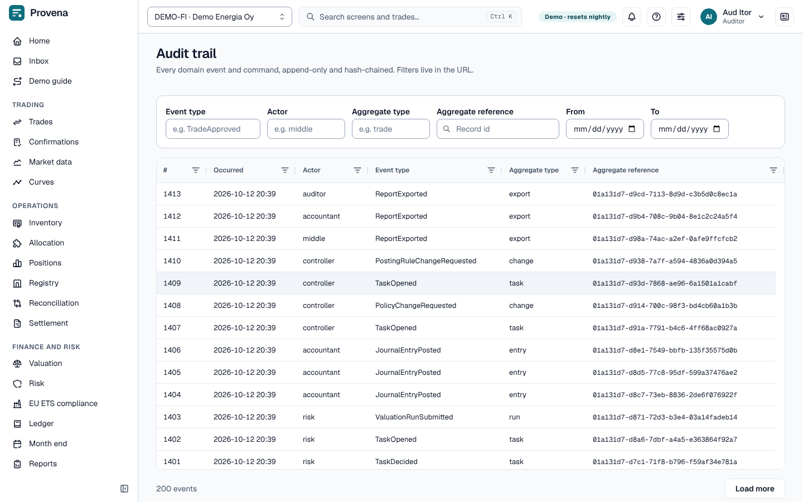

# Administration

## Reference data

Tabs for **Legal entities**, **Counterparties**, **Registries** and **Devices**; click a record to open it with its
accounts and books. Middle office maintains them; back office and registry operators maintain devices.

- Changes keep their history: open a record's **History** and view it **As of** an earlier time.
- **Sensitive data** (registry integration, counterparty registry accounts, bank accounts) changes through a
  **change request** that a second person approves (**Request change**). The **Change requests** screen lists them
  as **Pending**, **Applied**, **Rejected**, **Cancelled** or **All**; **Open the approval task** goes to the inbox.

## Production forecasts

Open a device to see its **Production forecast**: the expected production of the next twelve months, with the **P90**
figure that production should reach in nine cases out of ten, and the **Source** of each month. Allocation plans use
these figures for certificates that are not issued yet, and [Future supply](positions.md#future-supply) shows them.
The device page also shows its **Issuance lag (days)**, the time from the end of a production month until the
registry issues its certificates; set it when you add or edit the device.

- A month marked **Entered** or **Imported** has a forecast; point at it to see who recorded it and when.
- A month marked **Load-factor estimate** (dashed) has none. Its figures are the capacity times the technology's load
  factor, and only an estimate. Edit the month to record a forecast instead.
- **Edit** (the pencil) sets the expected and P90 MWh of a month, as whole numbers with the P90 not above the expected
  figure. Only middle office can.
- **Import forecasts** takes a CSV file with the header `gsrn,month,expected_mwh,p90_mwh` and one line per device and
  month, with the month like `2026-11`. The result lists how many lines were **imported** and **rejected**, with the
  reason for each rejected line; the lines that are fine are kept.

Under the device list, **Load factors** shows the share of capacity each technology produces in each month, with the
P90 factor beneath. They are illustrative defaults, not measurements. Middle office can edit a cell; a factor is
between 0 and 1 and the P90 factor is not above it.

## Taxonomy and products

The **Taxonomy** screen holds the code sets behind the criteria: energy sources, technologies, labels, regions and
support schemes. **Products** has three tabs: **Buckets** (the standard buckets), **Allowance products** and
**Futures contracts**. The **Buckets** table has a **Contained in** column that shows which larger buckets contain
each bucket, for example **Nordic hydro** in **European hydro** and **Nordic renewable**; **Top level** means no larger
bucket contains it, and **same as** names a bucket that holds exactly the same certificates. The same hierarchy is the
tree behind the **Products** view of [Positions](positions.md#products-and-netting).

## Audit trail

Every change, with who made it, when and why. Auditors, accountants, middle and back office and risk read it. Filter
by **Event type**, **Actor**, **Aggregate type**, **Aggregate reference** and dates; click an event to see its
payload as recorded, and **Show every event of this record** to follow one record.

## The demo

See [The demo](demo.md#resetting-the-demo) for the reset.
