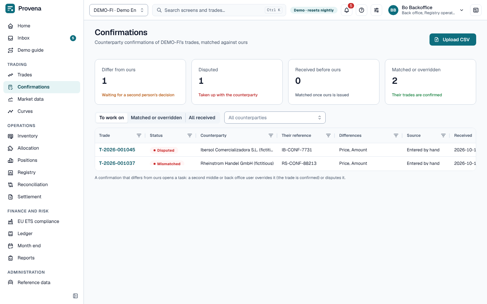

# Confirmations

Our confirmation of a trade is issued as a PDF; the counterparty's confirmation is entered or imported and matched
against ours, field by field.

## Our confirmation

On a trade's **Confirmations** tab, **Issue our confirmation** renders the PDF from the trade's current version. An
amendment supersedes the earlier confirmation when it is issued again.

## Their confirmation

- **Enter their confirmation** (on the trade's **Confirmations** tab, once ours is issued) starts from our terms;
  change what their document says.
- Several confirmations can be imported as a CSV file with **Upload CSV** on the **Confirmations** screen.

The **Confirmations** screen opens with four cards: confirmations that differ from ours, disputed ones, ones
received before ours, and ones matched or overridden. The list shows **To work on** by default; switch to **Matched
or overridden** or **All received**. Open a confirmation to see their terms against ours, field by field.

Matching compares product, quantity, price, dates and accounts. A full match confirms the trade.

## Breaks

A mismatch opens a **confirmation break** task (**Break task** on the confirmation opens it). A second person
(middle or back office, not the one who received the confirmation) decides it:

- **Approve** overrides the difference: the trade is confirmed, recorded as an override.
- **Reject** disputes it: the trade is marked disputed until it is amended or confirmed again.

> **Try it in the demo:** the **Confirmations** screen lists a mismatched and a disputed confirmation. Open the
> mismatch as *Max Middle* and decide it in the inbox.
