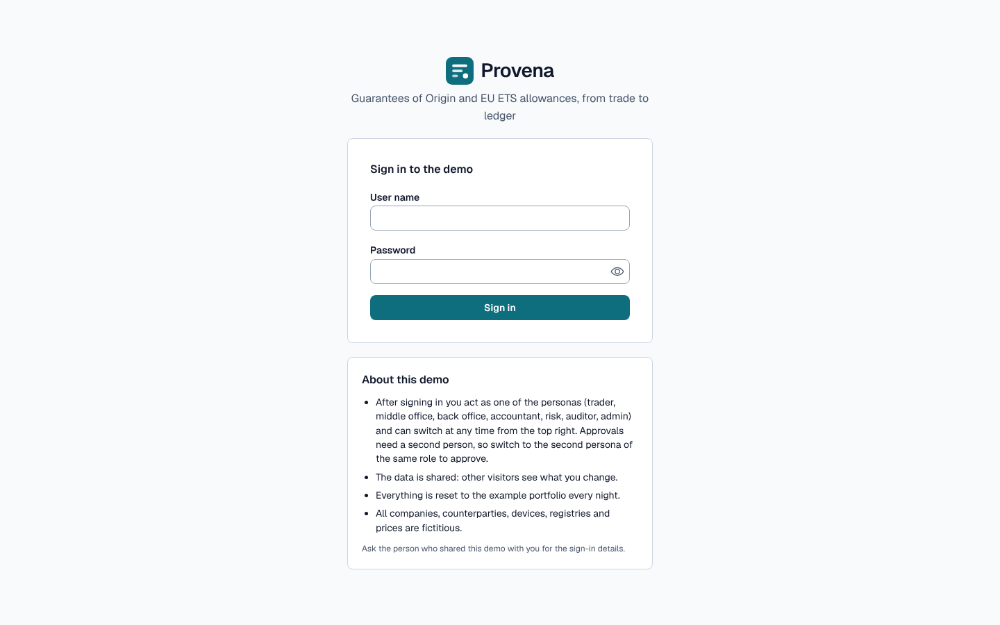
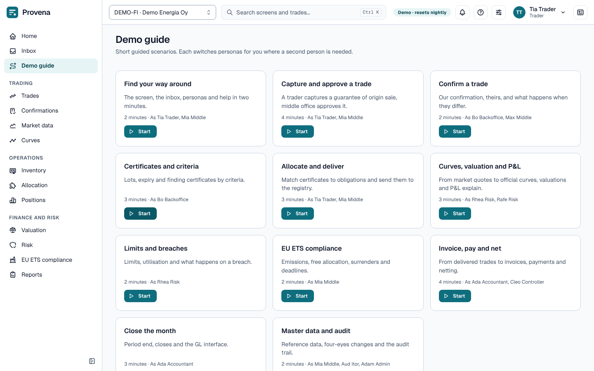
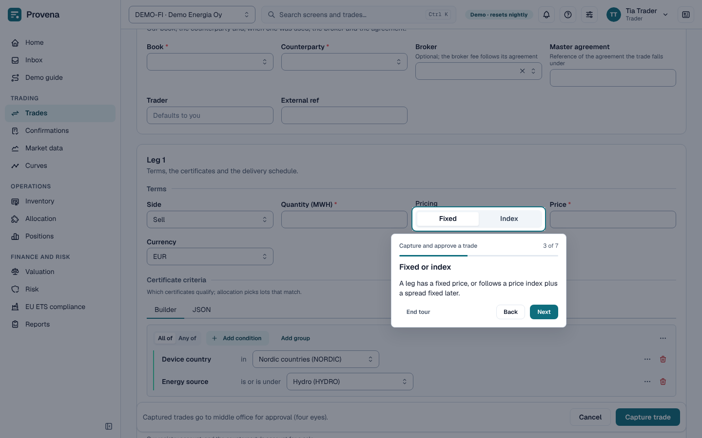
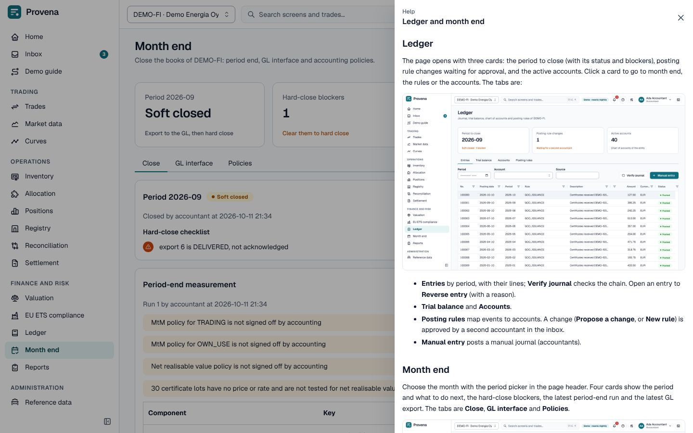

# The demo

This is a working system with fictitious companies, counterparties, certificates and prices. Everything you do is
real within the demo: trades are validated, approvals need a second person, and the ledger posts.

## Personas

After signing in you act as a **persona**: a person with a role. Switch persona from the menu at the top right.
Approving roles have two persons each, so you can play both sides of a four-eyes step.

| Persona | Role |
|---|---|
| Tia Trader, Theo Trader | Trader |
| Mia Middle, Max Middle | Middle office |
| Bo Backoffice | Back office and registry operator |
| Ada Accountant, Cleo Controller | Accountant |
| Rhea Risk, Rafe Risk | Risk |
| Aud Itor | Auditor |
| Adam Admin | Administrator |

The audit trail records the persona, not your sign-in name. Two visitors using the same persona count as one person
for the four-eyes checks.

## What the example data holds

About six months of business for two companies:

- **DEMO-FI** (Finland, euros) and **DEMO-SE** (Sweden, Swedish kronor), each with trading books, registry accounts
  and production devices.
- **Counterparties** across Europe, a broker, a clearing house, and the two companies as intercompany
  counterparties of each other.
- **Market data:** daily exchange rates, EU allowance spot and December futures, GoO prices by product bucket and
  vintage, and a GoO price index with monthly fixings.
- **Trades:** GoO forwards and spots, EUA forwards and futures, index-priced trades, an intercompany sale with its
  mirror, an amendment and a cancellation, confirmations matched, mismatched and disputed.
- **Certificates** in every state, allocation plans executed and waiting, registry transfers confirmed and failed.
- **Finance:** invoices paid, partly paid, overdue and credited, a netting, month-end valuations and closes, limits
  with breaches, EU ETS compliance for both countries.
- **Work in every inbox**, so each approving persona has something to decide.

## Things to try

1. As *Tia Trader*, capture a trade ([how](trading.md#capture-a-trade)); as *Mia Middle*, approve it in the inbox.
2. As *Bo Backoffice*, confirm it and record its delivery; as *Ada Accountant*, invoice it and let *Cleo
   Controller* issue the invoice.
3. As *Rhea Risk*, open a limit in breach and see its utilisation and breaches.
4. As *Ada Accountant*, open month end and see what blocks the hard close of last month.

## Shared and temporary

- **Everyone shares the same data.** Other visitors may change what you are looking at.
- Do not enter anything real: no real names, accounts or prices.

## Resetting the demo

The demo is rebuilt from scratch every night at 04:15 (Helsinki time). The *Adam Admin* persona can also reset it
from **Administration → Demo**, with a reason and by typing `RESET` to confirm, but not within ten minutes of the
last start. The page also shows when the example data was created and when the next nightly reset is. A reset
takes a minute or two; everyone is signed out and the example data is created again.
