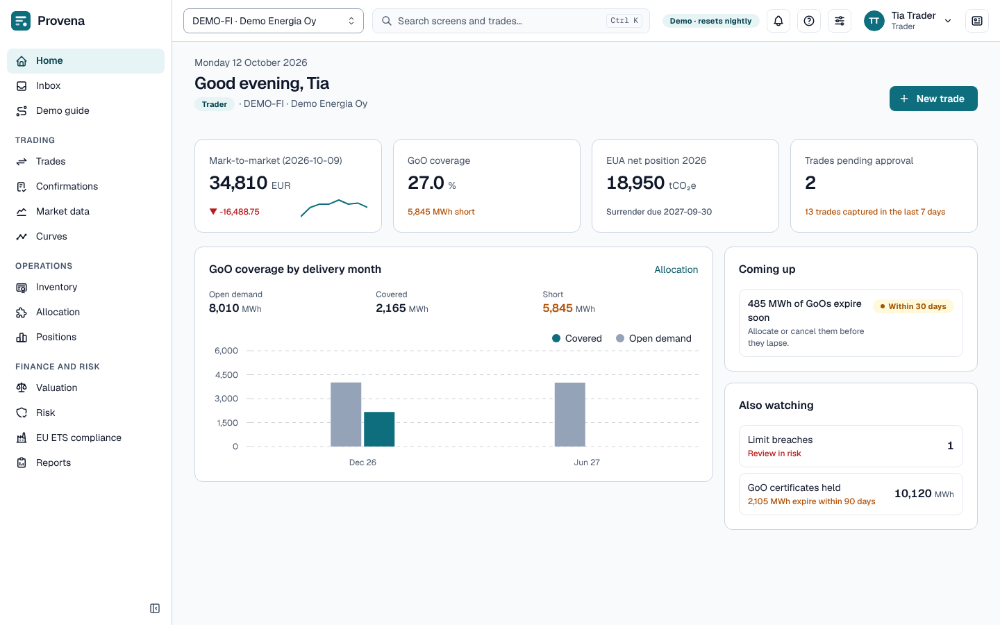
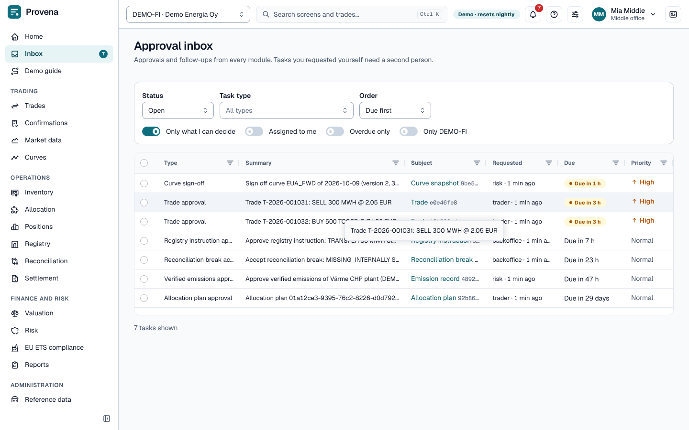

# Getting started

Provena is a trading and risk management system for Guarantees of Origin (GoO) and EU emission allowances (EUA).
It follows a certificate from the trade to the registry, the invoice and the general ledger, with a second person
approving every step that moves value.

## The screen

- **Sidebar.** The areas you may use, grouped into trading, operations, finance and risk, and administration. What
  you see depends on your roles: a trader has no settlement screen, an auditor reads but does not act.
- **Legal entity.** The selector at the top left scopes every screen to one of your companies (in the demo
  `DEMO-FI`, which books in euros, and `DEMO-SE`, which books in Swedish kronor).
- **Search.** `Ctrl K` (or `/`) opens the command palette: jump to a screen, find a trade by number, external
  reference or UTI, or search this manual.
- **Home.** Opens with a strip of cards with the figures that matter to your roles (tasks, trades pending approval,
  coverage, mark to market, open breaks, overdue invoices, limit breaches); the rest are listed under **Also
  watching**. Below are **My work**, **Coming up** (deadlines and period close) and **Recent activity**. Click a card
  to open its screen.
- **Inbox.** The bell and the Inbox item show the tasks waiting for you.
- **Help.** The `?` button opens the part of this manual that explains the screen you are on.
- **Display.** Light or dark, comfortable or compact rows; kept in your browser.

## The inbox

Every approval goes through the inbox: trades, allocation plans, curve snapshots, valuation runs, limits,
verified emissions, invoices, posting rules, cash flow hedge designations and discontinuations, master data
changes and reconciliation breaks.

- By default the list shows open tasks you may decide (**Only what I can decide**). Switch that off to see tasks that
  wait for someone else, or use the status, task type and order selectors and the other switches to narrow the list.
  A task you requested yourself cannot be decided by you: the system refuses the same person on both sides (four
  eyes).
- Click a task to open it. The **Decision** panel lists the four-eyes checks with a tick or a cross: you hold a
  deciding role, and you did not request the task. Give a **Reason** (required for some decisions), then **Approve**
  or **Reject** (**Acknowledge** for follow-up tasks such as a limit breach). The owning area applies the decision at
  once. The task's **History** shows who did what and when.
- A task links to its subject (the trade, the plan, the invoice), so you can check it before deciding.
- To decide several tasks at once, tick them in the list. A bar appears with **Approve** and **Reject** for the
  selected tasks you may decide.

> **Try it in the demo:** switch to *Mia Middle* and open the inbox. Approve a pending trade, then switch to
> *Tia Trader* and see the trade approved.

## Roles

| Role | Typical work |
|---|---|
| Trader | Captures and amends trades, checks limits, proposes allocations |
| Middle office | Approves trades, confirms them, maintains products and reference data |
| Back office | Confirms and delivers, runs registry instructions and reconciliation |
| Registry operator | Operates registry accounts and instructions |
| Accountant | Invoices, payments, period end, the general ledger and month end |
| Risk | Curves, valuations, limits and credit support |
| Auditor | Reads everything, including the audit trail |
| Admin | Everything, including the demo reset |

## Numbers and dates

- Amounts are computed by the server and shown with their currency; quantities with their unit (MWh for
  guarantees of origin, tCO2e for allowances).
- Periods are shown as from–to, where the end date is not included (a delivery window `2026-01-01 – 2027-01-01`
  is the calendar year 2026).
- Times are in UTC.

## Where next

- [The demo](demo.md): personas, what the example data holds, and the nightly reset.
- [Trading](trading.md): capture a trade and follow it through approval and confirmation.
- [Glossary](glossary.md): the terms used on the screens.
