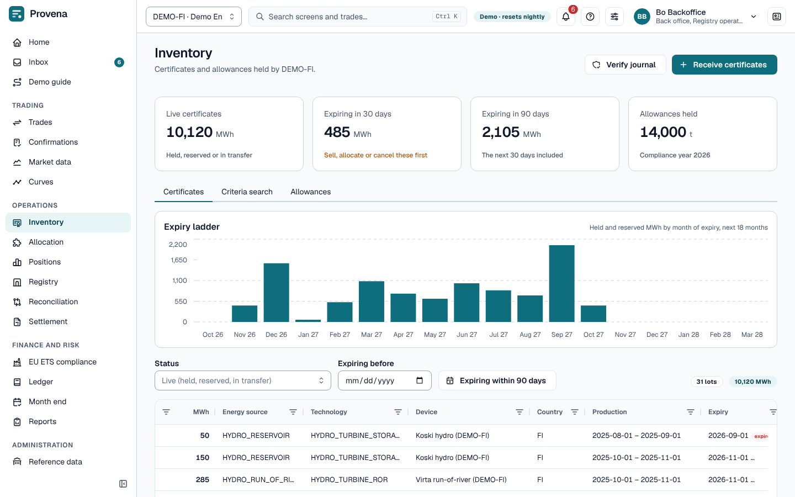
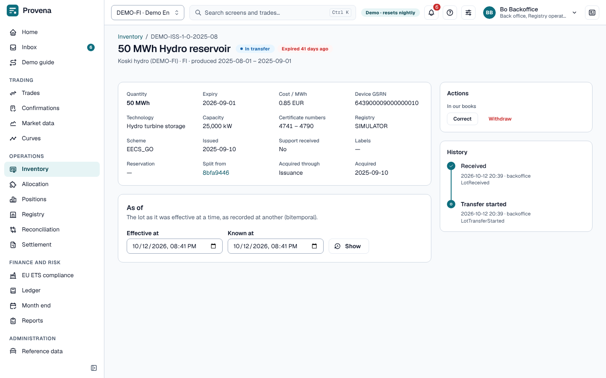
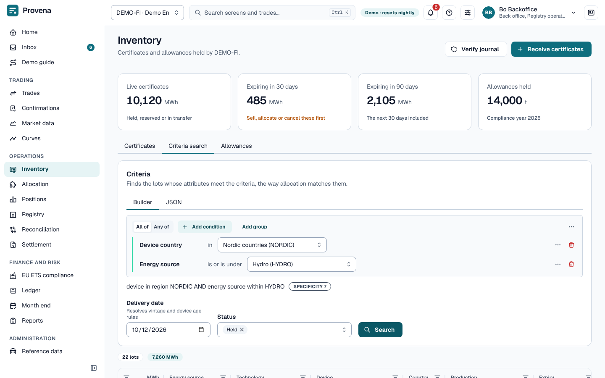

# Inventory

Certificates are held as **lots**: a contiguous range of certificate numbers with identical attributes in one
registry account. Emission allowances are held as **holdings** per account and product.

The page opens with four cards: live certificates, certificates expiring in 30 days, certificates expiring in 90
days, and allowances held. The tabs are **Certificates**, **Criteria search** and **Allowances**.

## Certificates

The **Certificates** tab lists the live lots of the entity, with an **expiry ladder** of MWh by month of expiry.
Open a lot to see its key facts, its **History** (every event in the hash-chained lot journal) beside them, and
what you may do with it under **Actions**.

- The list and the criteria search show at most 2,000 lots; when that many come back, a notice says the list may be
  cut off and the totals cover only the lots shown.
- **Receive certificates** (back office, registry operator), in the page header, records lots that arrived in our
  account.
- On a lot, **Actions** are in two groups. **In the registry:** **New transfer** to another account and **Cancel in
  the registry** for a beneficiary (disclosure or own consumption). **In our books:** **Reserve** (all or part; a
  part splits the lot), **Release**, **Split**, **Correct** (expiry, support, labels and cost), **Cancel for
  disclosure** and **Withdraw**. You only see the actions your roles and the lot's status allow.
- **Verify journal**, also in the page header, checks the hash chains of the lot journals and of the allowance
  movements.

## Criteria search

Find lots by criteria, the same builder as on trades: which certificates would satisfy a delivery, and how many.

## Allowances

Holdings per Union Registry account. Choose a holding to see its movements. **Record movement** books purchases,
sales, transfers and free allocation by hand; **Allowance transfer** submits a Union Registry transfer (it waits for
a second person in the inbox).

> **Try it in the demo:** as *Bo Backoffice*, open a held hydro lot, reserve part of it and look at its history.
