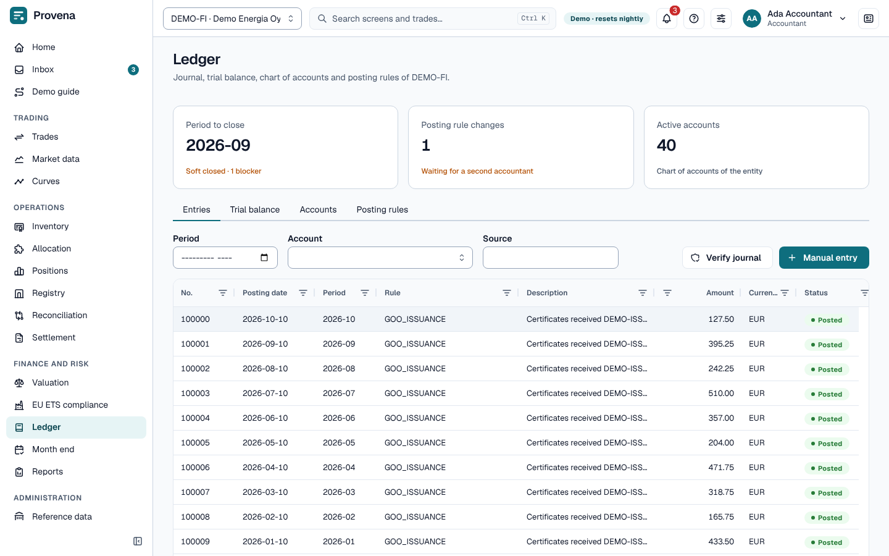
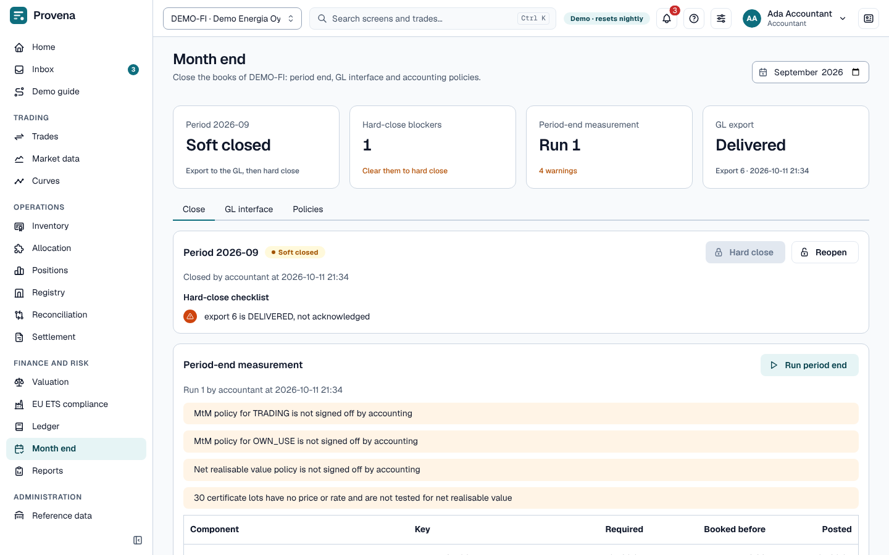

# Ledger and month end

Every business event posts to the general ledger through **posting rules**. The journal is append-only and
hash-chained: corrections are reversals, never edits.

## Ledger

The page opens with three cards: the period to close (with its status and blockers), posting rule changes waiting for
approval, and the active accounts. Click a card to go to month end, the rules or the accounts. The tabs are:

- **Entries** by period, with their lines; **Verify journal** checks the chain. Open an entry to **Reverse entry**
  (with a reason).
- **Trial balance** and **Accounts**.
- **Posting rules** map events to accounts. A change (**Propose a change**, or **New rule**) is approved by a
  second accountant in the inbox.
- **Manual entry** posts a manual journal (accountants).

## Cash flow hedges

**Hedges** in the *Finance and risk* menu (also at `/ledger/hedges`, read by accountants, auditors, risk and middle
office) lists the cash flow hedges of the selected legal entity. A hedge links forwards you hold to a highly probable
forecast purchase or sale of allowances or certificates, so that the forwards' value changes wait in equity (the
hedging reserve) until the transaction happens. The three cards count the active hedges, designations waiting for
approval and discontinuations waiting for approval; the list can be filtered by status.

- **Designate hedge** (accountants) opens the form: the direction, the product (an allowance product, or a bucket and
  an optional production year for certificates), the quantity, the expected date and currency, and the risk
  management objective. Then choose the hedging **trades**: open fixed-price trades of the entity on the matching
  side (bought forwards for a purchase, sold forwards for a sale), each with a **proportion** above 0 and up to 1. A
  trade can be designated at most in full across open hedges.
- **Four eyes.** A designation does not take effect until a second accountant approves it in the inbox (the task
  *Hedge designation*); the person who proposed it cannot. A rejected designation changes nothing.
- **Documentation.** On approval the system locks the hedged item's official forward price and the instruments'
  value on that day, and issues the hedge documentation as a PDF (objective, item, instruments, ratio, checks and
  method). **Hedge documentation** on the hedge opens it. Hedge accounting applies from the designation date;
  earlier valuations are never measured (no backdating).
- **Checks.** The hedge shows the prospective checks made at designation: product, currency, delivery within 31 days
  of the expected date, and a hedge ratio between 80 % and 125 %. They inform the approver; a check that is not met
  does not block the designation.

On the **Effectiveness** tab every official valuation run of the entity, signed off after the designation, adds one
measurement that is never changed afterwards: the instruments' value and its change since designation, the value of
a hypothetical forward at the locked price, the **reserve** (effective part), the **ineffective** part and the
dollar offset in percent. The reserve is the *lower of* the instruments' change and the hypothetical derivative's
value when both move the same way; the remainder, including the instruments' value before designation, goes to
profit or loss. The chart shows the three lines per valuation date. Until the next official valuation is signed off
the tab says there is nothing to show.

At month end, **Run period end** posts each active hedge by itself, with component *Cash flow hedge* (keys such as
`H-00001:RESERVE` and `H-00001:INEFFECTIVE`): the instruments' value, the reserve (account 2950) and the ineffective
part to profit or loss. Like the other revaluations it posts only the difference from what is booked and is
reversed on the first day of the next period. The instruments are physically settled forwards, so when they deliver,
the allowances are booked at the contract price, which is the hedged price; nothing is left to recycle. The report
*Hedge effectiveness* lists the measurements of a period.

**Discontinue** (accountants, on an active hedge) asks for a reason and whether the forecast is **still expected**. A
second accountant approves it in the inbox (*Hedge discontinuation*). If the forecast is still expected, the reserve
is **frozen** at its last measured amount while the instruments are open, and the hedge shows it as the frozen
reserve. If it is no longer expected, the reserve is recycled, so everything goes to profit or loss.

> **Try it in the demo:** the demo designates one hedge with its documentation and leaves a second one in the inbox
> for a second accountant. Measurements start with the next official valuation you sign off.

## Month end

Choose the month with the period picker in the page header. Four cards show the period and what to do next, the
hard-close blockers, the latest period-end run and the latest GL export. The tabs are **Close**, **GL interface** and
**Policies**.

1. On **Close**, **Run period end** posts the revaluations and accruals the month needs (re-running posts only the
   difference).
2. **Soft close** stops ordinary postings; **Reopen** if something was missed.
3. On **GL interface**, **Export to GL** exports the month to the general ledger (**Export as CSV file** saves it;
   **CSV** downloads an earlier export). Mark it **Delivered**, then record the ERP's answer with **Acknowledge**
   (with its GL reference) or **Reject**. **Import GL balances** compares the ledger with the ERP.
4. **Hard close** is possible once the **Hard-close checklist** on the Close tab is clear (every export
   acknowledged, nothing pending).

On **Policies**, accounting policies (e.g. allowance costing) change through **Request policy change**, approved by
a second accountant.

> **Try it in the demo:** last month is soft closed and its export not yet acknowledged, which blocks the hard close.
