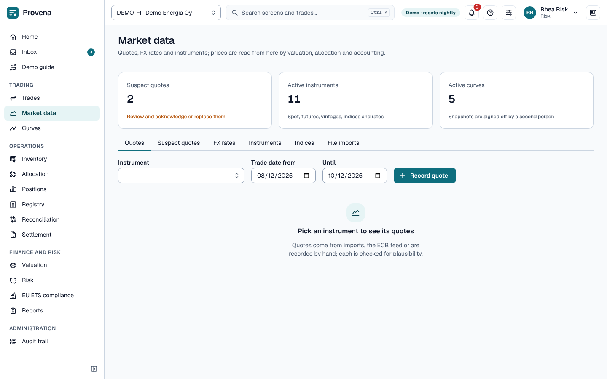
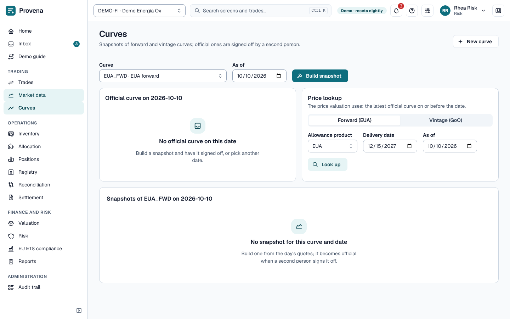

# Market data

Prices and rates come from market data only; no other screen stores a price.

## Quotes, rates and imports

The page opens with three cards: **Suspect quotes**, **Active instruments** and **Active curves**. The tabs below
hold the detail.

- **Quotes** per instrument and day (settlement, mid, bid, ask, close, fixing). Pick an instrument to see its
  quotes; **Record quote** adds one by hand. The **Suspect quotes** tab lists the flagged ones; give a reason and
  **Acknowledge** a quote that is right.
- **FX rates**: direct, inverse or across euros, with a staleness limit. **Pull ECB rates** loads the day's rates.
- **File imports** load quotes from files; **Import formats** map a file's columns (JSON).
- **Instruments** (EUA spot and futures, GoO vintages, indices) and their **aliases** in outside sources
  (**Add alias**).
- **Indices** are fixed from an instrument's quotes by a rule (on the date, the day before, or the month's average).
  **Fixing lookup** shows the fixing of an index for a date.

## Curves

A **curve** gives forward prices by delivery period for one product, built from the quotes of a day. A curve
snapshot becomes **official** when a second person signs it off in the inbox.

- **New curve** (in the page header) defines one (product or bucket, currency, quote types, staleness limit and an
  optional proxy curve).
- Choose the **Curve** and the **As of** date; **Build snapshot** sits next to them and builds a snapshot from that
  day's quotes. It opens the snapshot.
- A snapshot's page shows its key facts (points, gaps, currency) and a **Lifecycle** timeline: built, submitted for
  sign-off, signed off as official. **Submit for sign-off** sends a draft to the inbox; **Sign-off task** opens the
  task. On a draft you can **Override** a pillar's price with a note.
- **Official curve on** the chosen date shows the official snapshot; **Price lookup** reads a forward EUA price or a
  GoO vintage price from the official curves.

> **Try it in the demo:** as *Rhea Risk*, open the EUA forward curve and look up the price for next December.

## Discount curves

A **discount curve** gives the interest rate for one currency, by tenor. Valuation uses it to discount a payment to
its value today (see [Discounted mark to market](valuation.md#discounted-mark-to-market)). Create one with **New curve**
and the kind **Discount**; it takes a currency and a **Day count** instead of a product or bucket.

- **Rates by tenor.** The points are zero rates in percent a year, one for each tenor: `ON` (overnight), or a number of
  days, weeks, months or years such as `1W`, `3M` or `10Y`. They come from the quotes of **Rate** instruments. When you
  create a rate instrument, give its **Tenor** (optional); the snapshot then places its quote on that tenor. A snapshot
  of a discount curve shows each tenor, its date and the rate, in the column **Rate (% a year)**.
- **Negative rates.** A rate may be zero or negative, for rate quotes and for the curve.
- **Day count.** ACT/360 or ACT/365F: how the days to a payment become years. Leave it empty and a euro curve gets
  ACT/360, any other currency ACT/365F. The curve's page shows it next to the currency.
- **One per currency.** Each currency has one active discount curve. A currency without an official discount curve is
  not discounted: the factor is 1.
- **Sign-off.** Snapshots are built, submitted and signed off by a second person like those of other curves. Valuation
  reads only the official snapshot.
- **Discount factor lookup.** On the curve page, the **Price lookup** card has a third choice, **Discount factor**. Pick
  a currency, a **Payment date** and the **As of** date, and **Look up** shows the factor, the zero rate, the days to
  payment, the curve and its date. Between two tenors the rate is interpolated by calendar days; beyond the last one it
  stays flat. If the currency has no official discount curve, the page says so and the factor is 1.
