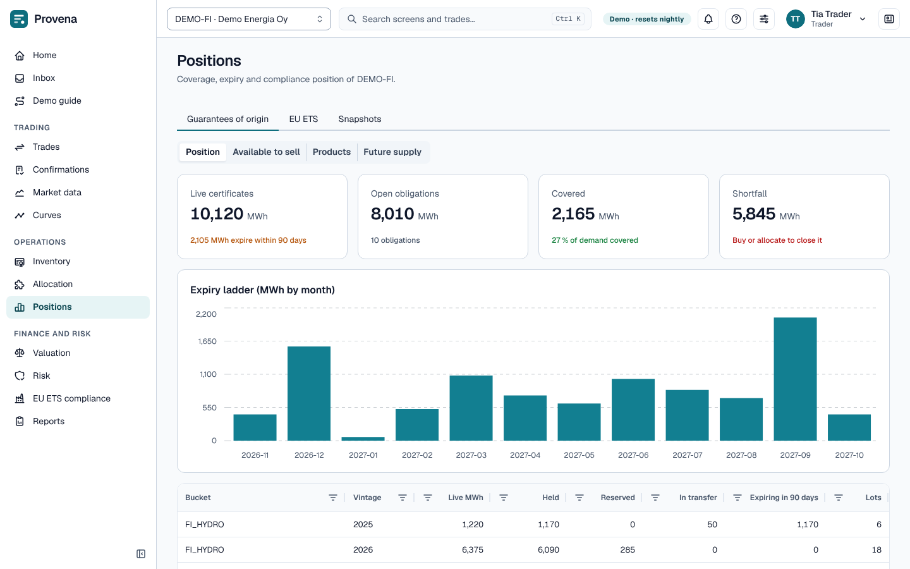

# Positions

## GoO positions

The **Guarantees of origin** tab opens with four cards: **Live certificates**, **Open obligations**, **Covered** and
**Shortfall**, all in MWh. Below them are the **Expiry ladder (MWh by month)** and a table by product bucket and
vintage: live, held, reserved and in-transfer MWh, what expires within 90 days, and the number of lots. **Shortfall** is the open demand that the
certificates held cannot cover.

## Available to sell

On the **Guarantees of origin** tab, switch the view from **Position** to **Available to sell** to see how much of
each bucket and vintage the entity could still sell. A row is a bucket and vintage with the MWh **Held**; there is
one column for each delivery month-end, holding the most a new sale for that date could receive from the
certificates held without taking anything from sales already agreed. Existing sales may be moved onto other
certificates that serve them too.

The cells are upper bounds on the same supply, so they **do not add up**: a certificate counted in one row can serve
a sale from another row's criteria. They also leave out device caps and the minimum shares of existing sales. The
first time an entity is opened the figures take a moment to prepare; the time they were worked out is shown under the
table. The view is open to traders, middle office, back office and risk.

The same figures check a sale while you capture it; see [Available to sell](trading.md#available-to-sell).

## Products and netting

On the **Guarantees of origin** tab, choose **Products** to see the portfolio as a tree of product buckets. A bucket
that fits inside a larger one is indented under it: **Nordic hydro** sits inside **European hydro** and inside
**Nordic renewable**. Use the arrow on a row to open or close what is inside it. The first two levels are open when
the view opens. A bucket with more than one larger bucket is listed under each of them, with the same figures, and
the later listings carry an **also under** label that names the bucket where it was listed first. Point at a product
to see the buckets that are the same as it.

The columns, in MWh unless stated:

- **Long**: certificates held inside the bucket.
- **Short**: open obligations that only certificates inside the bucket can serve.
- **Covered within**: how much of that short the bucket's own certificates can cover, matching each certificate only
  to obligations it qualifies for.
- **Short after netting**: **Short** minus **Covered within**. This is what has to be bought or issued, and it is
  shown in amber when it is more than zero.
- **Naive net**: **Long** minus **Short**, without looking at which certificates qualify.
- **Free**: certificates in the bucket that no obligation uses.
- **Available to sell**: what a new sale of exactly this product could still receive.
- **Mark**, **Cheapest to deliver** and **Give-away**, in EUR per MWh: the bucket's mark for the current vintage, the
  lowest value among its free certificates, and the difference between the two. Give-away is a management figure and
  is never booked.

**Naive net** can mislead. It treats every certificate as if it served every obligation. Say the entity holds 1,000
MWh of wind certificates and has sold 800 MWh of hydro. In the top row, which contains both, **Long** is 1,000 and
**Short** is 800, so **Naive net** reads long 200 MWh. But wind cannot be delivered against a hydro sale: the
certificates in the bucket cover none of the 800 MWh, so **Covered within** is 0 and **Short after netting** is 800
MWh, in amber. The entity has to buy hydro certificates, and the 200 MWh it seems to have in hand is only wind.
Read **Short after netting** to see what is missing. Point at a **Naive net** cell that looks long while the bucket is
short after netting, and the application says so.

The first time an entity is opened the figures take a moment to prepare; the time they were worked out is shown
under the table. The view is open to traders, middle office, back office and risk. The product hierarchy itself is
shown in [Taxonomy and products](administration.md#taxonomy-and-products).

## EU ETS position

The **EU ETS** tab shows allowances held against the entity's compliance obligation, for the **Compliance year** you
choose. Four cards give the net position (long or short), allowances held, emissions and the surrender deadline.
The table lists the same figures per installation.

## Snapshots

Positions are kept as snapshots at the end of each day. The **Snapshots** tab charts them over a period; **Take
snapshots now** stores today's positions (middle office, back office, risk, accounting).
