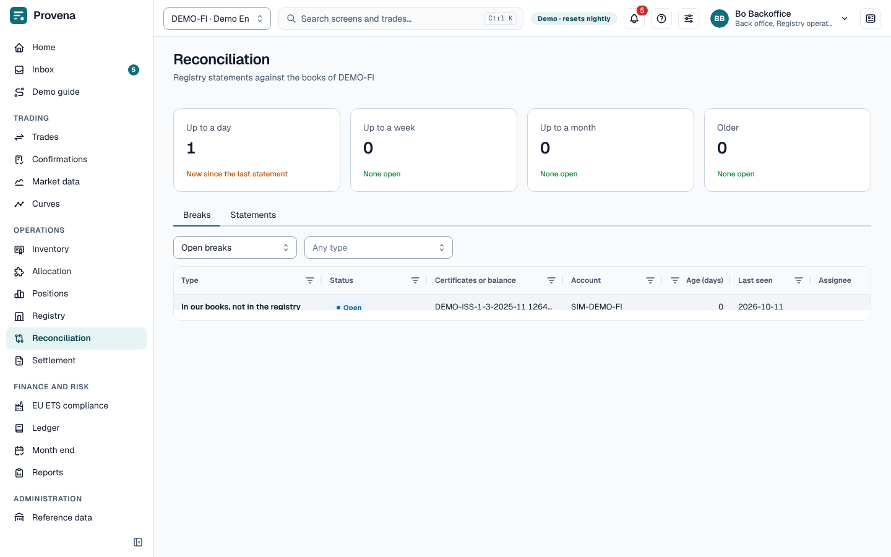

# Reconciliation

Registry statements are compared with our books. Every difference is a **break**, identified across statements, so
the same difference is not reported twice.

The page opens with four cards that count the open breaks by age: up to a day, up to a week, up to a month, and
older. The tabs are **Breaks** and **Statements**.

## Statements

On the **Statements** tab, choose an account and **Upload holdings statement** (its format comes from the
registry's statement format); it is reconciled at once. **Upload transaction export** confirms or fails open
instructions from a registry's transaction export. The tab lists the statements of the account; open one to see its
lines and breaks. A statement that was imported but not reconciled yet offers **Reconcile**.

## Breaks

The **Breaks** tab shows open or closed breaks; filter by type. Open a break to see its key facts, a **Lifecycle**
timeline and the differences between the registry and our books. **Take** assigns it to you. Under **Resolve**,
choose the action that fits: confirm the transfer, record a receipt, withdraw or replace a lot, correct a lot or
book the difference for a holding, or **Accept as is**. Accepting needs a second person to approve it in the inbox.

> **Try it in the demo:** the **Breaks** tab has open and closed breaks. **Take** an open one as *Bo
> Backoffice*.
