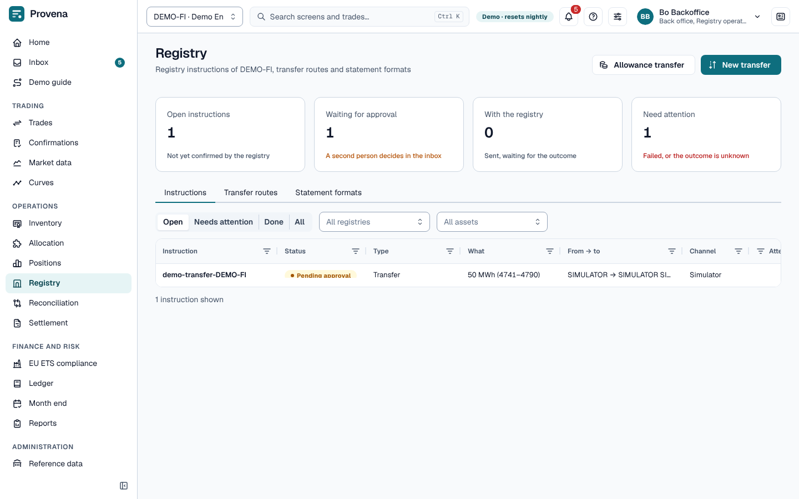
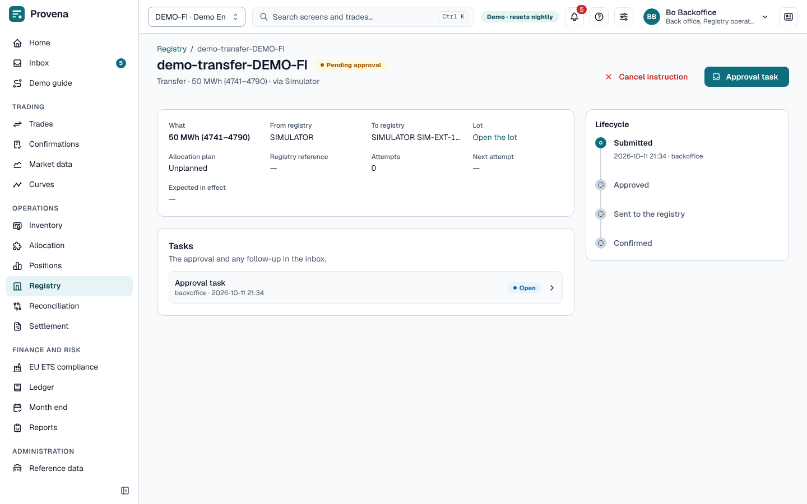

# Registry

Everything that moves certificates or allowances in a registry is an **instruction**: transfers, cancellations,
allowance transfers and surrenders. Instructions are stored first and sent afterwards (never inside a database
transaction), so nothing is lost if a registry is slow.

## Instructions

The **Instructions** tab opens with four cards: open instructions, those waiting for approval, those with the
registry, and those that need attention (failed, or the outcome is unknown). Switch the list between **Open**,
**Needs attention**, **Done** and **All**, and filter by registry and asset.

- Statuses: pending approval, pending (approved, waiting to be sent), dispatching, sent, unknown (the outcome is not
  known yet), acknowledged, confirmed, failed and cancelled.
- A transfer or cancellation waits for a second person in the inbox before it is sent.
- Click an instruction to open it. The page shows its key facts, a **Lifecycle** timeline (submitted, approved, sent
  to the registry, confirmed) and its **Tasks**: the approval and any follow-up.
- On the instruction, **Confirm executed** or **Mark failed** by hand where the registry is operated manually;
  **Retry** a failed instruction; **Cancel instruction** withdraws it.
- **New transfer** (GoO) and **Allowance transfer** (Union Registry) start one from this screen.

## Transfer routes and statement formats

- **Transfer routes** say whether certificates can move between two registries, at what fee and in how many days.
- **Statement formats** map a registry's statement file to our fields (JSON), per registry and profile.

> **Try it in the demo:** a failed transfer waits with a follow-up task. Open it as *Bo Backoffice*.
