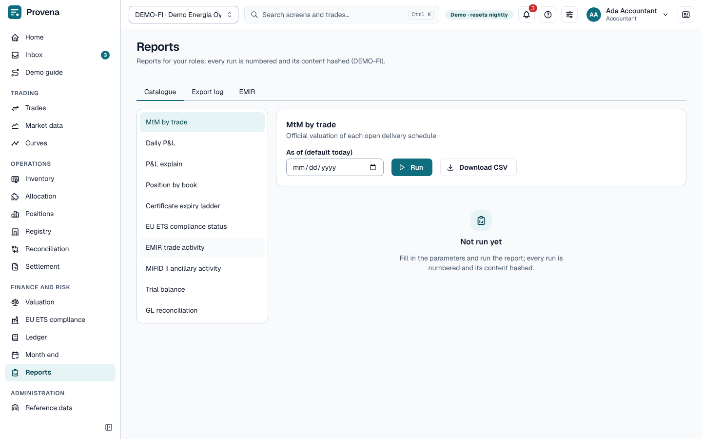

# Reports

The **Catalogue** lists the reports you may run, with their parameters. Pick a report, fill in the parameters and
choose **Run** to see the rows, or **Download CSV**. A report is produced in the background, so a large one does not
time out: the button shows progress until the rows appear or the file downloads. Until you run it, the screen says
**Not run yet**. Every run is
numbered and logged with a hash of its content in the **Export log**, where an earlier export can be downloaded
again with **Download again**. The content of an export is kept for the retention period (400 days unless your
administrator set another); after it the log shows **Content expired**, and the number and hash still prove what was
produced. Run the report again for new content.

**GoO give-away** lists, for a period, every sale of the allocation plans approved in it, as the plan valued it:
- the MWh delivered;
- the value of the certificates that delivered it;
- the mark of the sale's own product;
- the give-away, the premium handed over when more valuable certificates delivered it.

The **to** date is included. The figures are those of the plan when it was made, so a line that later failed at the
registry is still listed.

## EMIR

The **EMIR** tab shows **Reporting completeness**: whether every reportable trade has all its fields. Reportable
trades are reported as new, modified, terminated and valued. Record a rejection from the trade repository with
**Report error** on the event; the next export carries the correction.
