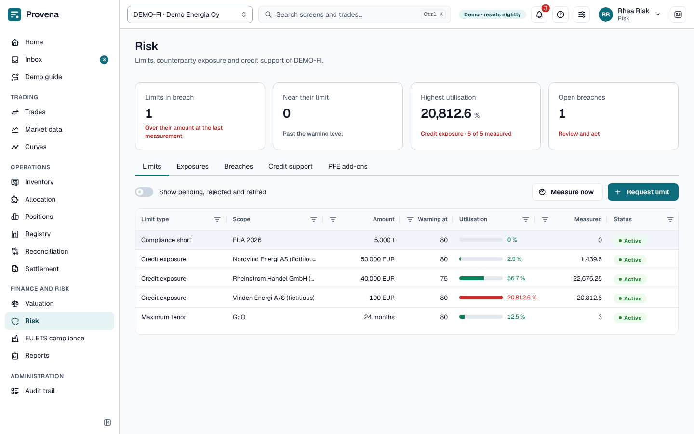

# Risk

The page opens with four cards: **Limits in breach**, **Near their limit**, **Highest utilisation** and **Open
breaches**. The tabs below are **Limits**, **Exposures**, **Breaches**, **Credit support** and **PFE add-ons**.

## Limits and breaches

On the **Limits** tab, limits cap exposure by type (credit exposure, net position, maximum tenor, stop loss month to
date, compliance short, and the three [GoO limits](#goo-limits)) and scope (whole entity, book, product family). **Request limit** sends a new limit for
approval; a change (**Request change**, on the limit's page) needs a second risk person too. Switch on **Show
pending, rejected and retired** to see limits that are not active.

Utilisation is measured on demand (**Measure now**) and by schedule. Open a limit to see its key facts, its
utilisation, its breaches and a **Lifecycle** timeline. A breach opens a task to acknowledge or resolve it; the
**Breaches** tab lists them, and **Open breaches only** hides the closed ones.

## GoO limits

Three limit types cap the risk of holding Guarantees of Origin that nothing uses. They apply to the whole legal
entity, so the form hides **Book** for them. Like every limit they are requested by one risk person and approved by
a second.

| Type | What it measures | Scope | Unit |
| --- | --- | --- | --- |
| **GoO concentration** | Unsold certificates of one product bucket: held GoO that no obligation uses once the eligibility flow has netted them. It is the book's open exposure to that bucket. | **Product bucket**, required | MWh, or EUR at the bucket's mark |
| **GoO expiry** | Held certificates that expire within the horizon and that no obligation uses. | **Horizon (days)**, 1 to 730, required; **Product bucket**, optional | MWh only |
| **GoO basis** | Sales delivered with certificates worth more than their own product (the give-away). | The whole entity | MWh, or EUR |

Any GoO limit can be narrowed to one **Vintage** (a production year). Concentration and expiry then count only the
certificates produced in that year, and an EUR concentration uses that vintage's mark. Basis counts only the sales
marked at that vintage. Leave the vintage empty to cover all vintages.

For concentration and basis, choose the **Unit**: MWh, or EUR to measure in money. EUR for a concentration limit uses
the bucket's mark; any other currency is refused. The list and the limit's page show the bucket and the horizon in
the **Scope** column (for example *NORDIC_HYDRO · expiring within 90 days*) and the unit next to the amount.

Utilisation is measured like that of other limits (**Measure now**), and a breach opens the same task.

A GoO limit also works before a trade is made. A purchase of the limit's bucket that would take its unsold
certificates over a concentration limit gets a pre-trade finding named `GOO_CONCENTRATION`: **Needs risk approval**
when the limit would be exceeded, **Warning** when it would pass the warning level. GoO trades also get a
`LIMIT_IN_BREACH` finding for a GoO limit that is already in breach. A limit with a vintage counts only the
purchase's deliveries of that vintage.

A GoO sale is checked against the basis limits. Its deliveries are served from the free certificates that qualify,
cheapest first. The premium of those certificates over the sale's own product is what the sale would hand over. When
that would take a basis limit over it, the trade gets `GOO_BASIS` with **Needs risk approval**; past the warning
level it gets a **Warning**. While the figures for the entity are still being prepared, the check says *not checked*
and does not hold the trade up. The findings show on the trade under
**Pre-trade checks**, and **Check limits** shows them without storing anything; see
[Approval and pre-trade checks](trading.md#approval-and-pre-trade-checks).

> **Try it in the demo:** DEMO-FI has four approved GoO limits, one of them in warning and one on last year's vintage. Open **Risk**, then
> **Measure now**.

## Exposures and credit

The **Exposures** tab shows exposure by counterparty, including the potential future exposure (PFE) add-ons, which
the **PFE add-ons** tab lists with their calibration. On the **Credit support** tab, **Request credit support**
sends guarantees and collateral for approval; they reduce exposure once approved.

## Pre-trade checks

Every trade is checked against the limits when it is captured; see [Trading](trading.md#approval-and-pre-trade-checks).

> **Try it in the demo:** DEMO-SE has an open limit breach. Acknowledge it as *Rhea Risk*.
