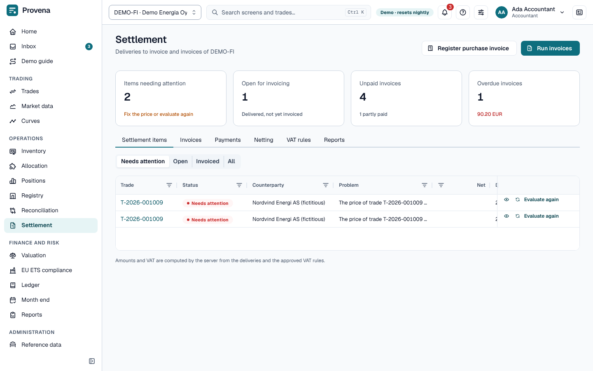
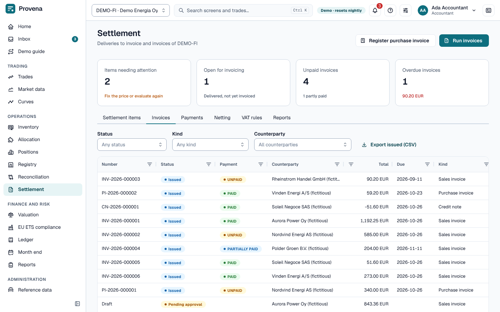
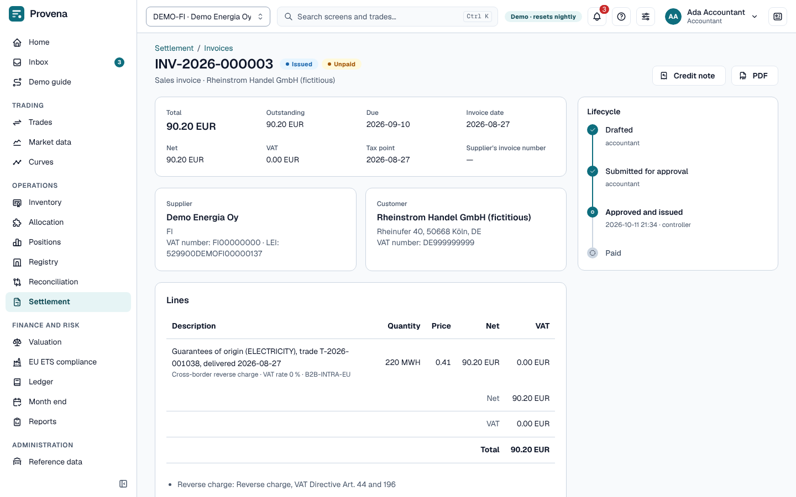

# Settlement

Every recorded delivery becomes a **settlement item**: what is owed, at what price and with which VAT treatment.
Items are invoiced, invoices are paid, and payments with the same counterparty can be netted.

The page opens with four cards: items needing attention, items open for invoicing, unpaid invoices and overdue
invoices. **Run invoices** and **Register purchase invoice** are in the page header. The tabs are **Settlement
items**, **Invoices**, **Payments**, **Netting**, **VAT rules** and **Reports**.

## Items

The **Settlement items** tab starts with the items that need attention. Switch between **Needs attention**,
**Open**, **Invoiced** and **All**; the eye opens an item with its price, VAT and source. An item of an index-priced
trade waits until its price is fixed (**Fix price**). An item of an exchange future margined through a clearing account is priced at the
future's final settlement price (the settlement price of its last trading day): the daily margin has already paid
the difference to the trade price. It waits until that price is stored.

## Invoices

1. **Run invoices** (for one counterparty or all) creates drafts from open items delivered up to a date.
2. Open a draft and **Submit for approval**; a second accountant approves and issues it in the inbox (**Approval
   task**). Issued invoices get their number and a **PDF**. The invoice page shows its key facts and a **Lifecycle**
   timeline. **Discard** removes a draft; its deliveries become open again.
3. **Register purchase invoice** registers a supplier's invoice, matched against our open purchases.
4. A **Credit note** on an issued invoice drafts the correction.

The list shows the newest invoices first, a hundred at a time; **Load more** fetches the next ones.

## Payments and netting

- **Record payment** by hand or **Import bank statement** (CSV), then **Allocate** payments to invoices. Unapplied cash stays
  visible; **Only payments with unapplied cash** filters the list. Payments are listed newest first, a hundred at a
  time, with **Load more** below the list.
- **Netting** offsets receivables and payables with one counterparty in one currency. **Prepare netting**, then
  another person records the counterparty's agreement (**Record agreement**) before **Settle**.

## VAT

VAT rules decide the treatment by product, country and counterparty (including reverse charge). **Propose VAT
rule** sends a new rule for a second person to approve; **Find the rule** shows which rule applies to a case.

## Reports

The **Reports** tab has the ageing report, the cash forecast, the VAT report and the EC sales list.

> **Try it in the demo:** as *Ada Accountant*, run invoices for *Aurora Power* and submit the draft; issue it as
> *Cleo Controller*.
