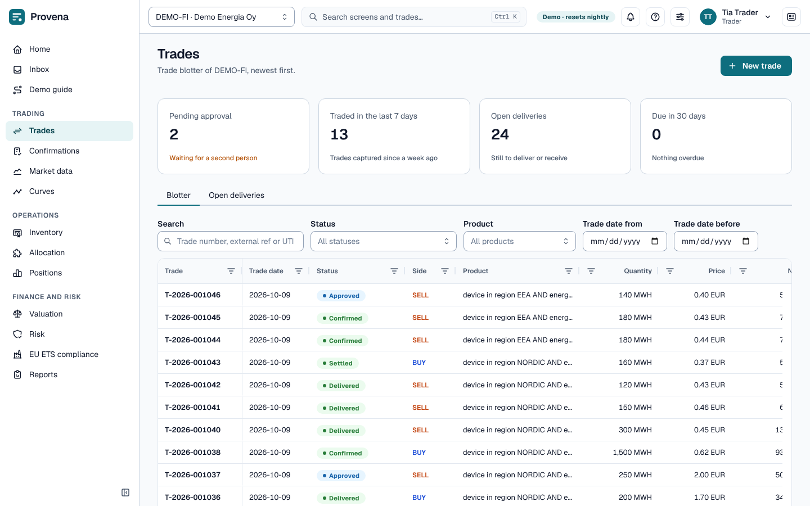
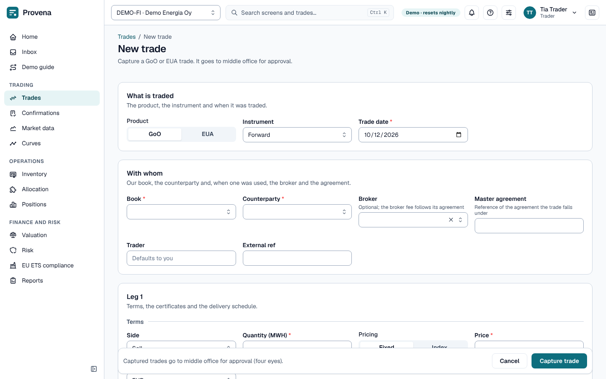
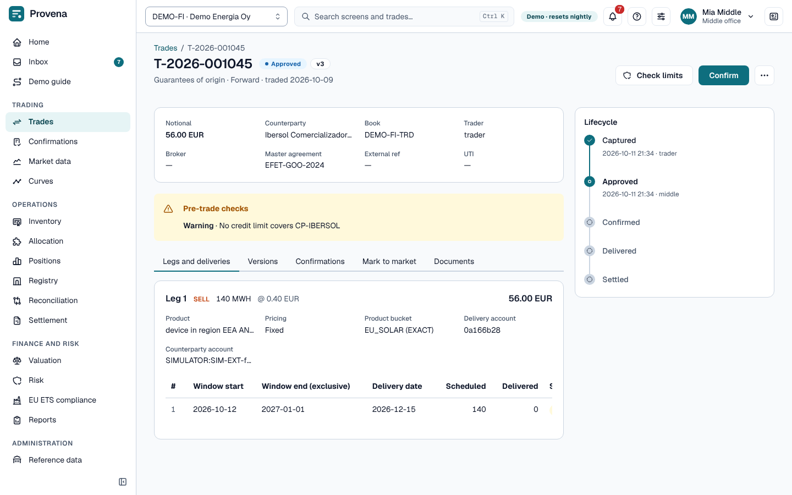
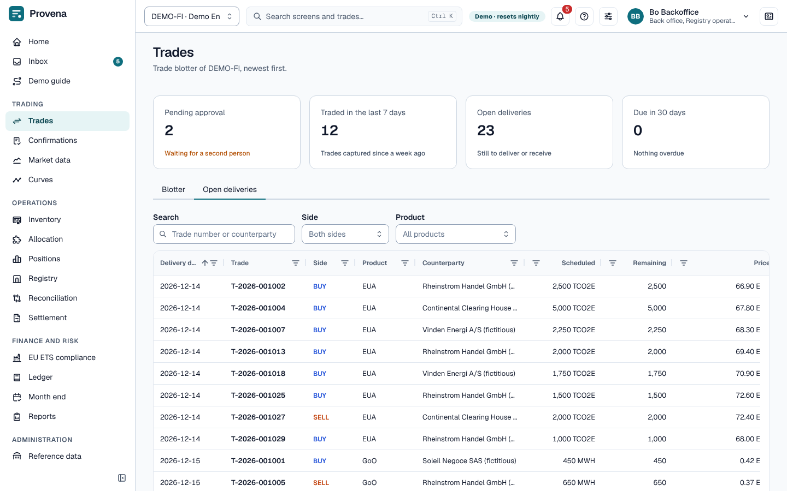

# Trading

Trades are captured by traders (or by middle office on their behalf), approved by a second person, confirmed with
the counterparty, and then delivered and settled. The blotter under **Trades** shows the trades of the selected
legal entity, newest first. It opens with four cards: trades pending approval, trades captured in the last 7 days,
open deliveries, and deliveries due in 30 days. Most cards link to the trades or deliveries behind them.

## Who does what

| Step | Who |
|---|---|
| Capture, amend, cancel | Trader, middle office |
| Approve or reject | Middle office or risk, never the person who captured the trade |
| Confirm, record deliveries, settle | Middle office, back office |
| Check limits | Trader, middle office, risk, auditor |

## The blotter

- Search by trade number, external reference or UTI; filter by status, product and trade date. Filters stay in
  the address, so a view can be bookmarked.
- The **Blotter** tab lists the trades. If none match your filters, an empty state offers **Clear filters**; with
  no trades at all it offers **New trade**.
- The **Open deliveries** tab lists what still has to be delivered or received, earliest first, across all trades.
  Click a row to open its trade.

## Capture a trade

Open **Trades → New trade**.

1. Choose the product (**GoO** or **EUA**), the instrument, the book and the counterparty.
2. For each leg: side, quantity, price and currency, and the delivery schedule (a window and a delivery date per
   delivery; the quantities must add up to the leg).
3. For guarantees of origin, describe which certificates qualify with the **criteria builder**: country or region,
   energy source, technology, support, device age, vintage and labels. The summary under the builder shows how the
   criteria read and how specific they are; the **JSON** tab shows the same criteria as text. Once the trade is
   captured, its **Legs and deliveries** tab shows the **Product bucket** the criteria fall in.
4. **Capture trade.** The trade waits for approval in the inbox of middle office and risk.

The form checks what it can before sending; anything the server refuses appears next to its field or at the top.

### Futures

Choose the instrument **Future**: the product switches to EUA and only exchanges and clearing houses are offered.
Pick the **futures contract**: it sets the allowance product, currency, venue and the single delivery on the
contract's delivery date. The quantity must be whole lots of the contract size.

### Options

Choose the instrument **Option**: the product switches to EUA and only exchanges and clearing houses are offered.
Each leg has **Option terms**:

- the **underlying contract**, the futures contract the option is on; it sets the allowance product and currency;
- the **type**, call or put, and the **strike** per tonne;
- the **expiry date**, from the trade date up to the contract's last trading day (the field under the contract shows
  it).

The price of an option leg is the **premium per tonne**, and the quantity is the tonnes of the underlying in whole lots
of the contract size. An option has no delivery schedule: exercise at expiry creates the future, which delivers. On the
trade page the option terms are listed on each leg in place of the deliveries table. After expiry the leg also shows
the **outcome** (exercised or abandoned), the settlement price and the date, and for an exercised option a link to
the future; that future carries a note "Created by exercise of" the option trade.

### Index pricing

Switch a leg's **Pricing** to **Index**, choose the price index and enter the **spread**. The price is fixed later
from the index fixing plus the spread; until then the delivery waits for its price in settlement.

### Broker, master agreement and intercompany trades

- **Broker** and **master agreement** are optional; the agreement field suggests the counterparty's agreements.
- When the counterparty is one of our own companies, the trade is **intercompany**: choose the **mirror book** of the
  other company. Its mirror trade is captured with this one, with the sides reversed.

## Approval and pre-trade checks

Every trade runs pre-trade checks (credit and limits) when it is captured. Findings are shown on the trade under
**Pre-trade checks**; a finding that needs risk approval is red. **Check limits** runs the checks again against
today's limits without storing anything.

The trade's **Approval task** button opens its inbox task. The trader can withdraw the trade from approval there
(**Cancel task**, with a reason), which cancels the trade.

> **Try it in the demo:** as *Tia Trader*, capture a GoO sale to *Aurora Power*. Switch to *Mia Middle* and approve
> it from the inbox.

## Available to sell

When a leg **sells** guarantees of origin, the capture form shows under each delivery how much you can still sell
for its criteria and delivery date: **Available to sell: N MWh**. It is worked out from the certificates the entity
holds and appears a moment after you stop typing; it is not shown to users who may not run the check, for purchases
and allowance trades, or when the figure cannot be worked out. When a delivery asks for more than is available, the
hint turns amber, says how much it asks for and names the supply that runs out (bucket, vintage and what is left of
it).

- **Existing sales stay whole.** The figure is the most a new sale could get without taking anything from sales
  already agreed. Those sales may be moved onto other certificates that serve them too, so a certificate they use is
  still counted as available when something else can take its place.
- **Deliveries of one trade compete.** Each delivery is checked on its own and then all together. When every delivery
  fits by itself but they do not fit together, a line under the leg says what they ask for and what the same
  certificates can serve.
- **An upper bound.** Device caps and minimum shares of existing sales are not in the figure, so a sale that fits can
  still leave the allocation short. The **Available to sell** table under **Positions** shows the figures for all
  delivery months.
- **Advice only.** The hint never blocks capturing or amending. When you amend a trade, its own deliveries are left
  out so they do not count against themselves.

**Check limits** and the pre-trade checks on a captured trade add the same check as a finding named
`GOO_HEADROOM`. A warning means a delivery does not fit; an information finding says the figures are still being
prepared, so the check was not made.

## Amendments and versions

A trade's page opens with its key facts (notional, counterparty, book, trader, references) and, beside them, a
**Lifecycle** timeline: captured, approved, confirmed, delivered, settled, with who did each step and when. A
cancelled or disputed trade ends in a failed step.

**Amend** is in the **More actions** menu (the three dots) at the top of the page, together with **Cancel trade**.
It opens the form with a reason; saving creates a new version, and an approved trade goes back for approval. The
**Versions** tab shows what changed between versions, field by field.

## Confirmation, delivery and settlement

- **Confirm** (shown once the trade is approved) records the counterparty's confirmation reference. Delivery
  obligations open when a trade is confirmed (or, for entities set up that way, when it is approved).
- The **Legs and deliveries** tab has a **Deliver** menu per delivery:
  - **Record delivery** by hand (date, quantity, reference);
  - **Transfer allowances** submits the Union Registry transfer for an allowance sale; the delivery is recorded when
    the registry confirms it;
  - **Match receipt** links a received lot (GoO) or an incoming allowance movement (EUA) to a purchase.
- A delivered trade can be settled with **Mark settled**.
- The **Documents** tab lists our confirmation PDFs with **Verify**, which checks the stored hash.
- The **Mark to market** tab shows the trade's value in the official valuation of the **Valuation date** you choose.

See [Confirmations](confirmations.md) for matching the counterparty's confirmation, and
[Settlement](settlement.md) for invoices.
