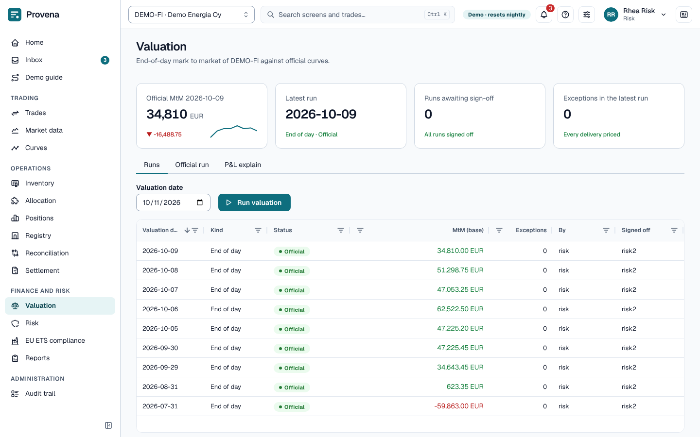

# Valuation

A **valuation run** values every open trade at the official curves of a day: mark to market by trade and delivery.

The page opens with four cards: the official mark to market of the latest official run, the latest run and its
status, the runs awaiting sign-off, and the exceptions in the latest run (deliveries without a price or rate). Three
tabs follow: **Runs**, **Official run** and **P&L explain**.

- **Run valuation** (on the **Runs** tab, with a **Valuation date**) starts a run. Runs are submitted by middle
  office or risk and made official by a second person.
- Open a run to see its key facts, a **Lifecycle** timeline and the **Results by delivery**, which you can filter by
  book. **Submit for sign-off** sends a draft to the inbox; **Sign-off task** opens the task.
- **P&L explain** compares two official runs, by cause: new trades, amendments, cancellations, deliveries, time to
  payment, price moves, discount rate moves, FX moves and what stays unexplained.
- **Official run** finds the official run of a date (or the latest before it).
- The results grid shows the **Pay date**, the **Discount factor** and the **MtM undiscounted** of each delivery; see
  [Discounted mark to market](#discounted-mark-to-market).
- In the results grid, **CTD (EUR/MWh)** and **MtM at CTD** appear for GoO sales; see [Portfolio value](#portfolio-value).

> **Try it in the demo:** compare the last two official runs on the P&L explain.

## Discounted mark to market

A payment later is worth less today. The mark to market of a delivery is the quantity times the difference between
the market price and the contract price, times the **discount factor** from the pay date to the valuation date:

- **Pay date** is when the delivery is paid. **Discount factor** comes from the official discount curve of the
  contract currency (see [Discount curves](market-data.md#discount-curves)); 1 means no discounting. **MtM
  undiscounted** is the amount in the contract currency before discounting.
- A currency with no official discount curve is not discounted, and neither are futures: their factor is 1.
- With negative rates the factor can be above 1.
- The trade's **Mark to market** tab shows the discount factor of each delivery too.

Two causes in the **P&L explain** come from discounting:

| Cause | What moved |
|---|---|
| Time to payment | The value of the earlier discount curve as the payment gets a day closer |
| Discount rate moves | The move of the discount curve itself between the two runs |

Time to payment is a steady drift from run to run; discount rate moves are the part that depends on the market.

## Portfolio value

Open a run and choose the **Portfolio** tab to see what the whole book is worth, not just the trades. It is a
**management view**: the official mark to market, the ledger, EMIR reporting and credit exposure stay on the bucket
curves and do not change. Runs without a portfolio value show a short note instead.

The **bridge** is a waterfall from the certificates you hold to the portfolio value, all in EUR:

- **Inventory value**: the certificates held, each at the best price it qualifies for.
- **Trade MtM**: the official mark to market of the GoO trades, in EUR.
- **Give-away**, **Transfer fees** and **Expiry haircut**: what it costs to deliver the open obligations from the book,
  on the valuation-grade allocation. Give-away is the value of certificates that are better than the obligation asks
  for.
- **Portfolio value** is the inventory value plus the trade MtM, less those three costs.

The cards above the bridge show the portfolio value, the inventory value, the MWh held and the **Shortfall**: MWh the
obligations need that the book cannot deliver. A note says how many MWh have no price.

Once the run is official, **Change against the prior official run** explains the move by cause:

| Cause | What moved |
|---|---|
| Trade MtM | The trades' mark to market |
| Inventory prices | Prices of the certificates already held |
| Certificates in and out | Certificates received or leaving the book |
| Give-away | The cost of delivering with better certificates than needed |
| Reallocation | A different allocation of certificates to obligations |
| Expiry | Certificates that expired or are about to |
| Unexplained | What is left over |

Below, the **Certificates by product bucket** and **Open obligations** tables show the parts. For each obligation,
**CTD (EUR/MWh)** is the cheapest to deliver: the average value per MWh of the certificates that deliver it. It is set
against the **Sale mark**, and the difference is the **Give-away**. The results grid on the **Results** tab shows the
same CTD price and the **MtM at CTD** for a GoO sale. Both are for information only.

On the **P&L explain** tab, **Portfolio explain** adds the causes in total for the same two dates, the portfolio value of
each official run in between, and the give-away handed over by allocation plans approved in the period.

> **Try it in the demo:** open the latest official run and choose **Portfolio**.
